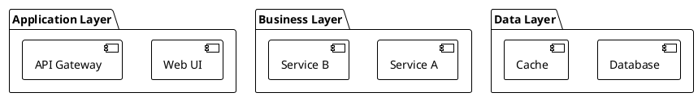

# Key Technology Research

## Research Goals

Deeply understand an open-source project's core technologies, key algorithms, and technical innovations, and grasp the project's technical depth and uniqueness.

## Research Steps You Must Perform

### Step 1: Identify the Core Technologies

**Content that must be researched and analyzed:**

- The main technologies and frameworks used by the project
- Core algorithms and data structures
- Key technical components
- The hierarchy of the tech stack

**Keywords to search:**

- "[project name] core technology"
- "[project name] key algorithms"
- "[project name] technology stack"
- "[project name] architecture overview"

**Information sources:**

- The technical section of the official documentation
- Architecture design documents
- The core modules of the source code
- The technical introduction in the README

### Step 2: Deeply Research the Key Algorithms

**Content that must be analyzed:**

- The principles and implementation of the core algorithms
- The time and space complexity of the algorithms
- The optimization points of the algorithms
- The technical origins and theoretical basis of the algorithms

**Key research questions:**

- What problem does this algorithm solve
- Where the algorithm's innovations lie
- What advantages it has compared to similar algorithms
- The algorithm's applicable scenarios and limitations

**Keywords to search:**

- "[project name] algorithm explanation"
- "[project name] how it works"
- "[project name] algorithm analysis"
- "[project name] technical deep dive"

**Information sources:**

- In-depth analysis on technical blogs
- Source code comments and documentation - Academic papers (if based on academic research)
- read_webpage to read technical articles

### Step 3: Analyze the Technical Innovations

**Innovations that must be identified:**

- What technical innovations and breakthroughs exist
- The problem the innovations target
- How the innovations are implemented
- The effect and value of the innovations

**Keywords to search:**

- "[project name] innovation"
- "[project name] novel approach"
- "[project name] unique features"
- "[project name] breakthrough"

**Information sources:**

- The founder's technical talks
- Technical papers and articles
- Community discussions and Issues
- Technical review articles

### Step 4: Research the Rationale for Technology Selection

**Technical decisions that must be analyzed:**

- Why these technologies and frameworks were chosen
- What alternative approaches were considered
- What trade-offs were made behind the choices
- The constraints of the technology selection

**Keywords to search:**

- "[project name] design decisions"
- "[project name] why [technology name]"
- "[project name] technical choices"
- "[project name] alternatives considered"

**Information sources:**

- RFCs and design documents
- Design explanations in code comments
- Decision analysis on technical blogs
- Technical discussions in the community

### Step 5: Analyze Performance Optimization Techniques

**Optimization strategies that must be researched:**

- What performance optimization techniques the project adopted
- Caching strategies and data structure optimization
- Concurrency and parallel processing techniques
- Resource management and optimization

**Keywords to search:**

- "[project name] performance optimization"
- "[project name] scaling techniques"
- "[project name] caching strategies"
- "[project name] concurrency"

**Information sources:**

- Performance optimization documents
- Benchmarks and analysis reports
- Optimization comments in the source code
- Performance analysis on technical blogs

### Step 6: Research Extensibility Design

**Extensibility that must be analyzed:**

- The extensibility design of the architecture
- Plugin and extension mechanisms
- Modular and decoupled design
- Interface and abstraction layer design

**Keywords to search:**

- "[project name] extensibility"
- "[project name] plugin system"
- "[project name] modular design"
- "[project name] API design"

**Information sources:**

- Architecture design documents
- API and plugin documentation
- Extension examples and tutorials
- Extension practices in the community

## Research Output Requirements

### Document Structure

**Document that must be produced:** `03_key_technologies.md`

**The document must contain the following sections:**

1. Core tech stack overview
2. Key algorithm analysis
3. Technical innovations
4. Technology selection analysis
5. Performance optimization techniques
6. Extensibility design
7. Reference list

### Content Quality Requirements

- **Must**: go down to the algorithm level, not just the framework level
- **Must**: analyze the rationale and trade-offs of technical decisions
- **Must**: provide concrete technical implementation details
- **Must**: compare the pros and cons of technical options
- **Must**: all technical analysis has sources
- **Must**: use diagrams to help explain complex technical concepts
- **Forbidden**: only listing tech stack names without in-depth analysis
- **Forbidden**: shallow descriptions lacking technical principles

### Diagram Drawing Requirements

**The following types of diagrams can be drawn using PlantUML:**

1. **Tech stack hierarchy diagram**: show the project's tech stack structure and hierarchical relationships
2. **Architecture component diagram**: use a Component Diagram to show core components and their interactions
3. **Data flow diagram**: use a Sequence Diagram or Activity Diagram to show the data flow process
4. **Algorithm flowchart**: use an Activity Diagram to explain the algorithm execution flow in detail
5. **Class diagram**: use a Class Diagram to show the structure and relationships of core classes
6. **Sequence diagram**: use a Sequence Diagram to show the temporal interactions between components
7. **State machine diagram**: use a State Diagram to show the system's state transitions
8. **Deployment diagram**: use a Deployment Diagram to show the system deployment architecture

**PlantUML usage suggestions:**

- Pair each complex technical concept with at least one diagram
- Diagrams should be concise and clear, highlighting the key points
- Add necessary text explanations before/after the diagram
- Use PlantUML syntax to ensure document readability and maintainability

**Example diagram format:**

## Research Depth Check

After completing this stage of research, you must confirm:

- [ ] You grasp the project's core tech stack
- [ ] You understand the principles and implementation of the key algorithms
- [ ] You identify the project's technical innovations
- [ ] You understand the decision process of technology selection
- [ ] You understand the performance optimization strategies
- [ ] All technical analysis has sufficient basis

## Technical Analysis Dimensions

### Algorithm Analysis Dimensions

**Must include:**

- The purpose of the algorithm and the problem it solves
- The basic principles and approach of the algorithm
- Time complexity and space complexity
- Comparison with similar algorithms
- The optimization points of the algorithm

### Architecture Analysis Dimensions

**Must include:**

- Architecture patterns and design principles
- The division of responsibilities of core components
- Data flow and control flow
- Interface design and abstraction levels
- Extension points and plugin mechanisms

### Performance Analysis Dimensions

**Must include:**

- Performance metrics and benchmarks
- Bottleneck analysis and optimization points
- Caching and storage strategies
- Concurrency and parallel processing
- Resource management and optimization

## Common Mistakes

**❌ Wrong approaches:**

- Only listing the tech stack without in-depth analysis
- Only describing features without explaining implementation principles
- Lacking analysis of the rationale for technical decisions
- Not paying attention to performance and extensibility

**✅ Correct approaches:**

- Go deep into the algorithms and implementation details
- Analyze the reasons and trade-offs of technology choices
- Pay attention to performance optimization and extensibility
- Compare different technical options

## Practical Tips

**In-depth research strategy:**

1. Start from the source code of the core modules to understand implementation details
2. Look at unit tests to understand boundary cases and special handling
3. Analyze performance test data to understand the optimization effect
4. Read technical papers to understand the theoretical basis
5. Compare implementations across versions to understand the evolution process
6. Look at technical discussions in Issues to understand design decisions
