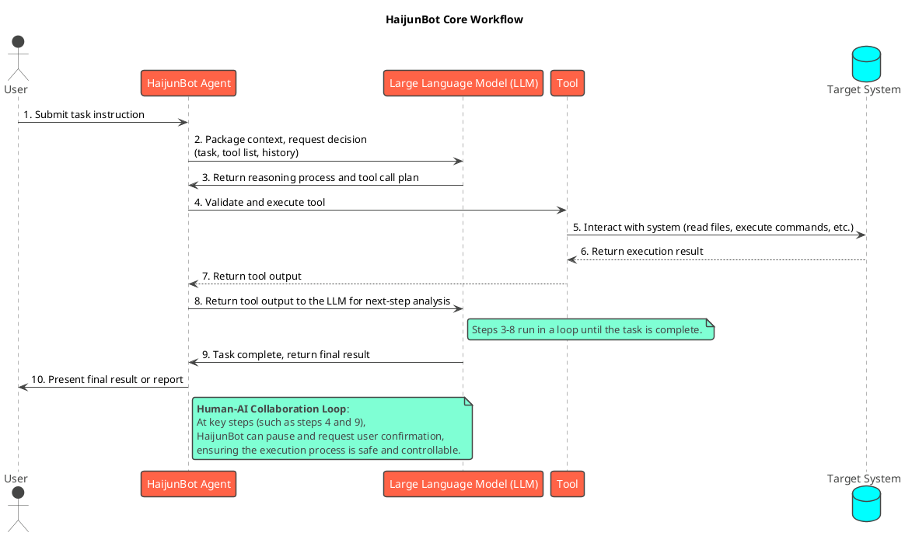

# 1. Project Introduction

## 1.1 What is HaijunBot?

HaijunBot is a powerful, extensible AI assistant framework designed to be your intelligent development and system interaction partner. It deeply integrates the capabilities of Large Language Models (LLMs) and, through a rich ecosystem of tools, applies the AI's analysis, reasoning, and execution capabilities to real-world development tasks and complex system management.

Unlike traditional AI chatbots, HaijunBot is designed as a "doer". It not only understands your intent, but can also autonomously or under your guidance invoke various tools to complete tasks, such as:

- Analyzing and modifying codebases
- Executing system commands and scripts
- Automating Git workflows
- Interacting with Web services
- Managing and querying local knowledge bases

The core philosophy of HaijunBot is **human-AI collaboration**. It acts as an intelligent bridge between human experts and complex systems, automating repetitive and tedious tasks so that developers can focus on higher-level creative work.

## 1.2 Core Features

HaijunBot's design is built around the following core features:

- **🛠️ Tool-driven**: Built-in toolset covering code development, system management, Web interaction, and many other domains. The AI can intelligently select and combine these tools according to task requirements to achieve its goals.
- **🔌 Highly extensible**: Every part of the system supports a high degree of customization. You can easily add custom tools, integrate new large model platforms, or connect to external services through the MCP protocol to build your own dedicated AI assistant.
- **👥 Deep human-AI collaboration**: HaijunBot supports user intervention at every key point of task execution. You can review the AI's plan, confirm high-risk operations, or even take over control directly in the virtual terminal, ensuring the final result always meets expectations. CodeAgent supports a virtual terminal tool, allowing interactive operations.
- **⚡ Task lists and dependencies**: Supports modular execution of complex tasks, with task dependencies, status tracking, and separation of branch flows from the main flow.
- **📈 Intelligent evolution and knowledge sharing**:
  - **Methodology system**: HaijunBot can learn from its interactions with you, crystallizing successful solutions into "methodologies" and referencing them when handling similar tasks in the future, making it smarter the more you use it.
  - **Central methodology library**: Supports sharing local methodologies to the team's central Git repository. This promotes the sharing and synchronization of knowledge and best practices among team members, enabling the whole team to grow together.

## 1.3 Main Functional Components

HaijunBot provides a series of command-line tools, each optimized for a specific application scenario:

- `haijunbot` (`hjb`): A general-purpose AI agent, suitable for open-ended tasks and system interaction.
- `haijunbot-code-agent` (`hca`): An agent designed specifically for code development tasks, skilled in code analysis and modification.
- `haijunbot-smart-shell` (`hss`): Smart Shell, providing an AI-enhanced command-line experience.
- `haijunbot-git-commit` (`hgc`): An automated Git commit tool that intelligently generates standardized commit messages based on code changes.
- `haijunbot-git-squash` (`hgs`): Squashes all commits after a specified base commit into a single new commit, and generates a summary commit message.
- `haijunbot-platform-manager` (`hpm`): AI platform and model management tool, supporting model conversations, API services, etc.
- `haijunbot-agent` (`ha`): Core agent tool, supporting finer-grained custom configuration.
- `haijunbot-tool` (`ht`): Directly invoke and manage HaijunBot's built-in and custom tools.
- `haijunbot-methodology` (`hm`): Manage and query saved methodologies for knowledge reuse.
- `haijunbot-memory-organizer` (`hmo`): Memory management tool, supporting organizing, merging, and importing/exporting memories.
- `haijunbot-sec` (`hsec`): Security analysis suite, combining heuristic scanning and AI deep verification, supporting security scanning and analysis for C/C++ and Rust languages.
- `haijunbot-c2rust` (`hc2r`): C→Rust migration suite, supporting gradual migration, resumable runs, and intelligent library replacement, implementing a complete automated migration pipeline from C/C++ code to Rust.
- `haijunbot-config` (`hcfg`): Configuration management tool, dynamically generating configuration Web pages based on JSON Schema.
- `haijunbot-lsp` (`hlsp`): LSP language server.
- `haijunbot-browser` (`hb`): Browser automation.
- `haijunbot-windows` (`hw`): Windows GUI automation.
- `haijunbot-web-gateway` (`hwg`): Web gateway service.
- `haijunbot-service` (`hservice`): One-click launch of the Web gateway and frontend services.
- `haijunbot-quick-config` (`hqc`): Quick configuration of LLM platforms.
- `haijunbot-rules-index` (`hri`): Rule index management.
- `haijunbot-code-agent-dispatcher` (`hcad`): A convenient wrapper for hca, supporting task dispatch and interactive mode.
- `install-playwright`: Playwright browser driver installation script.

Together these components form a comprehensive AI assistant ecosystem, meeting a wide range of needs from daily development to complex system operations.

## 1.4 Target Users

HaijunBot is primarily designed for the following user groups:

- **Software developers**: Those who want to improve coding efficiency, automate code review, and quickly understand and modify existing codebases with AI.
- **System administrators/DevOps engineers**: Those who need to automate complex system management tasks such as deployment, monitoring, and troubleshooting.
- **AI application developers and researchers**: Those seeking a flexible, extensible framework to experiment with and build LLM-based agent applications.

Whether you want to use AI as a capable assistant in your daily development, or want to explore the infinite possibilities of AI agents, HaijunBot provides you with a solid starting point.

## 1.5 System Architecture

HaijunBot's system architecture is designed for modularity and high extensibility. The following diagram shows its core components and their interactions:

```plantuml
@startuml
!theme vibrant

title HaijunBot System Architecture

package "User Interaction Layer" #AliceBlue {
    actor User as User
    [CLI Entry\n(hjb, hca, ...)] as CLI
}

package "HaijunBot Application" #LightGreen {
    node "Agent" {
        [Run Loop\n(AgentRunLoop)]
        [Output Handler]
        [Prompt Manager]
        [Session Manager]
        [Event Bus]
        [Tool Executor]
        [User Interaction Wrapper]

        [Memory Manager]
        [Task Analyzer]
        [File Methodology Manager]
    }

    node "Registries" {
        [Tool Registry]
        [Platform Registry]
    }
}

package "Pluggable Capabilities" #Orange {
    package "Tools" {
        [Built-in Tools]
        [External .py Tools]
        [MCP Tools]
        [Central Tool Library (Git)] as CentralTool
    }
    package "Platforms" {
        [Native .py Platforms]
    }
    package "Knowledge" {
        [Local Methodologies] as LocalMethodology
        [Central Methodology Library (Git)] as CentralMethodology
    }
    package "Memory System" {
        [Short-term Memory\n(In-memory)] as ShortMem
        [Project Long-term Memory\n(.haijunbot/memory)] as ProjMem
        [Global Long-term Memory\n(~/.haijunbot/memory/global_long_term)] as GlobalMem
        [Memory Tools\n(Save/Retrieve/Clear)] as MemTools
    }
}

package "Infrastructure Layer" #LightGrey {
    database "External Systems" as ExternalSystem
}

cloud "LLM Services" {
    [OpenAI API]
    [Haijun API]
    [Other LLM APIs]
}

User --> CLI
CLI --> Agent : Dispatch task

Agent --> Tool Registry : Use
Agent --> Platform Registry : Use
Agent --> [Run Loop\n(AgentRunLoop)] : Delegate run
Agent --> [Prompt Manager] : Build system/additional prompts
Agent --> [Session Manager] : Manage conversation/context
Agent --> [Event Bus] : Broadcast events
Agent --> [Tool Executor] : Execute tool calls
[Tool Executor] --> Tool Registry : Resolve and dispatch

Tool Registry --> [Built-in Tools] : Load
Tool Registry --> [External .py Tools] : Load
Tool Registry --> [MCP Tools] : Load via MCP
[External .py Tools] <--> CentralTool : Share/Sync (via ShareManager)

Platform Registry --> [Native .py Platforms] : Load

Agent --> [Native .py Platforms] : Send prompts
[Native .py Platforms] --> [OpenAI API] : Adapt and call
[Native .py Platforms] --> [Haijun API] : Adapt and call
[Native .py Platforms] --> [Other LLM APIs] : Adapt and call

[Built-in Tools] --> ExternalSystem
[External .py Tools] --> ExternalSystem
[MCP Tools] ..> "External Process" : Delegate

[File Methodology Manager] --> LocalMethodology : Read
LocalMethodology <--> CentralMethodology : Sync

[Memory Manager] --> MemTools : Manage
MemTools --> ShortMem : Access
MemTools --> ProjMem : Access
MemTools --> GlobalMem : Access

Agent --> [Memory Manager] : Use
Agent --> [Task Analyzer] : Use
Agent --> [File Methodology Manager] : Use
Tool Registry --> MemTools : Load

@enduml
```

**Architecture Description:**

- **User Interaction Layer**: Users communicate with HaijunBot and issue commands through a set of dedicated command-line tools (such as `hjb`, `hca`).
- **HaijunBot Core Framework**: This is the brain of the system.
  - **Agent**: Receives user instructions, collaborates with the LLM for thinking and planning, and schedules tools to execute tasks.
  - **Platform Registry**: Dynamically loads and manages all available AI platforms, and is the bridge connecting the core framework with AI capabilities.
  - **Tool Registry**: Dynamically loads and manages all available tools, and is the bridge connecting the core framework with tool capabilities.
  - **File Methodology Manager (FileMethodologyManager)**: Responsible for handling file uploads and loading local methodologies, providing capabilities in combination with methodology tool functions (load_methodology/upload_methodology), enabling HaijunBot to load experience before a task and to carry context through files when the history limit is exceeded.
  - **Memory Manager**: Manages the three-layer memory system (short-term, project long-term, and global long-term memory), supports persistent storage and flexible retrieval of information, and enables knowledge reuse across tasks and sessions.
  - **Model Context Protocol (MCP)**: By supporting MCP, HaijunBot can act as a universal "client" to securely and standardly integrate with any external tool or service ("server") that follows the protocol. An MCP service can be designed as a gateway to any functionality, such as accessing codebases, executing operating system commands, querying databases, or connecting to arbitrary Web APIs. This makes extending HaijunBot's capabilities as simple as plugging in a USB device, greatly enhancing its integration and extensibility in complex IT environments.
- **Capability Ecosystem**: This is the source of HaijunBot's functionality, mainly composed of three parts: AI platforms, tools, and knowledge/experience. Among them, the memory system provides a layered storage mechanism of short-term memory (temporary information in memory), project long-term memory (project-specific knowledge), and global long-term memory (cross-project general knowledge).
- **Infrastructure Layer**: Located at the very bottom of the architecture, it represents the specific foundational capabilities encapsulated and provided by the built-in tools, such as code operations and file system access. This is the ultimate implementation point of all of HaijunBot's concrete behaviors.

## 1.6 Core Workflow

Understanding how HaijunBot handles a task request can help you collaborate with it better. Below is a typical task processing flow:



**Process Description:**

1. **Task submission**: The user proposes a clear or open-ended task via the command line.
2. **Decision request**: The HaijunBot agent packages the task, the current context (such as the working directory and available tools), and the history of interactions, and sends them to the Large Language Model (LLM), requesting analysis and a decision.
3. **Plan generation**: The LLM "thinks", breaks down the task, and formulates the first step of the execution plan in the form of calls to specific tools.
4. **Tool execution**: The agent receives the instruction and invokes the corresponding tool. Before executing high-risk operations, it may pause and request user approval.
5. **System interaction**: The tool performs concrete operations on the target system, such as reading files, executing shell commands, or calling APIs.
6. **Result return**: The tool's execution result (success, failure, output data) is captured.
7. **Result reporting**: The result is returned to the agent.
8. **Iterative analysis**: The agent sends the execution result back to the LLM, letting it evaluate the current progress and decide whether the next step is to continue calling tools, revise the plan, or consider the task complete. This "think-execute-evaluate" loop continues.
9. **Task completion**: When the LLM determines the task is complete, it generates a summary final response.
10. **Result presentation**: The agent presents the final result or task report to the user.

This workflow combines the LLM's powerful planning ability with the tools' precise execution ability, while human-AI collaboration checkpoints ensure the transparency and controllability of the entire process.

## 1.7 Vibe Working: A More Intuitive Workflow

HaijunBot's core philosophy aligns with an emerging human-AI collaboration mode, **"Vibe Working"**. This concept originates from AI researcher Andrej Karpathy, and refers to using Large Language Models (LLMs) to efficiently transform vague, intuitive ideas in the human mind (i.e., "Vibe") into concrete, structured outcomes.

This is no longer the traditional "command-execute" mode, but rather a **conversational, iterative** co-creation process.

- **Start from a "feeling"**: Traditional automation requires precise inputs and rules. With HaijunBot, you can start from a vague goal, such as `hca "write me a script to monitor changes on this website"` or `hca "refactor the 'user' module to make it look cleaner"`. What you provide is direction and "feeling", not a detailed specification.

- **Approach perfection through iteration**: HaijunBot (or the LLM behind it) will provide an initial implementation. This version may not be perfect, but it is a solid starting point. Next, you guide it through feedback, such as `"the logic here is wrong; it should check A first, then handle B"` or `"can you make the variable names more semantic?"`. Through this rapid feedback loop, the AI's output will gradually approach your true intent.

- **The shifting roles of human and AI**:
  - **You (human)**: Play the role of **creative director, taste arbiter, and direction setter**. You are responsible for providing vision, experience, and high-level judgment, ensuring the quality and direction of the final result.
  - **HaijunBot (AI)**: Plays the role of **a powerful execution partner and inspiration catalyst**. It handles all the heavy, repetitive, and technical details, and can provide unexpected solutions that spark new ideas for you.

HaijunBot is precisely a tool designed for this workflow. Through seamless command-line integration and powerful local interaction capabilities, it transforms "Vibe Working" from an abstract concept into a daily productivity tool within reach for developers, allowing you to focus more on **high-value creative thinking** rather than trivial implementation details.
