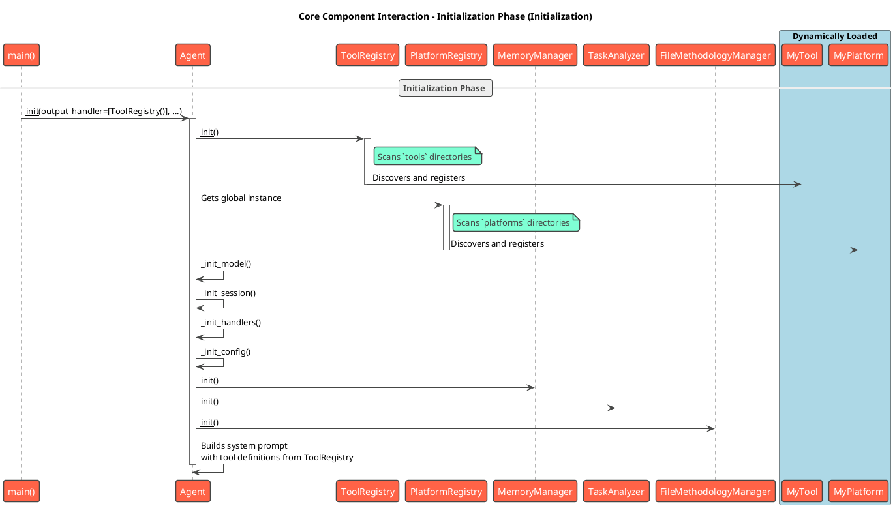
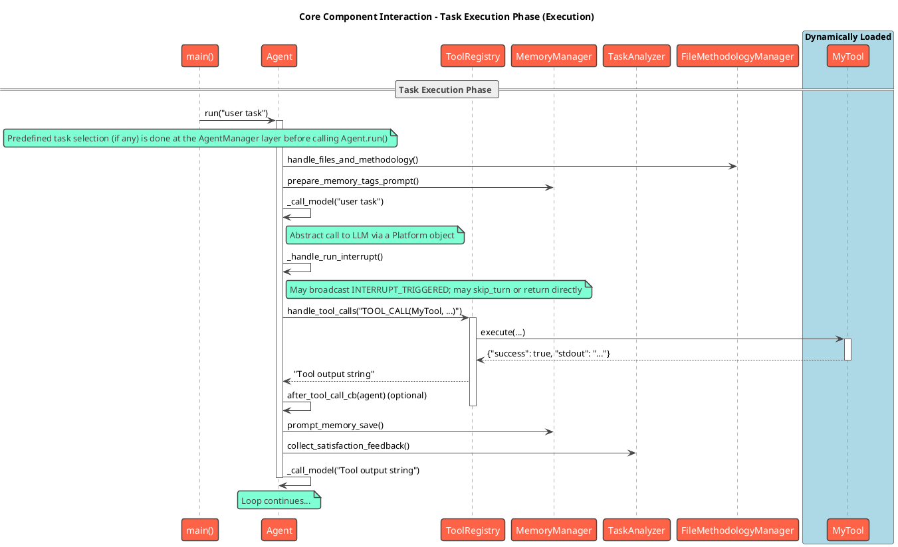

# 3. Core Concepts and System Architecture

This chapter explores HaijunBot's core concepts in depth and explains how they combine into an organic, extensible system. We will first introduce each core concept independently, then show how they work together through architecture diagrams and workflows.

## 3.1 Core Concepts

To gain a deep understanding of HaijunBot and use it effectively, it is essential to grasp several core concepts behind it. This section introduces the eight cornerstones that make up the HaijunBot system: **Agent**, **Tool**, **Platform**, **Model**, **Methodology**, **Memory System**, **Rules System**, and **Configuration System**.

### 3.1.1 Agent

**Agent** is HaijunBot's "brain" and execution hub, a highly flexible **coordinator and scheduler**. It does not itself contain complex business logic; instead, it drives the entire workflow through a **main loop**: acquiring capabilities, requesting decisions, delegating execution, and iterating.

The core design philosophy of the Agent is **delegation**. It delegates the concrete execution logic (such as tool invocation) to different **output handlers**. This makes the Agent's core completely decoupled from concrete capabilities. For example, `ToolRegistry` is an output handler dedicated to handling the `TOOL_CALL` tag.

### 3.1.2 Tool & ToolRegistry

**Tool** is HaijunBot's "hands": an atomic, single-purpose executable unit.

**ToolRegistry** is the manager of all tools. It is responsible for discovering, loading, and executing tools, and integrates them through three independent mechanisms:

1. **Built-in tools**: Load the native Python tools that ship with the project.
2. **External Python tools**: Load Python tools created by the user in a specified directory (such as `~/.haijunbot/tools`).
3. **MCP tools**: Communicate with external independent processes via the Model Communication Protocol (MCP) to access the tools provided by those processes; this is a key technique for advanced extension.

### 3.1.3 Platform & PlatformRegistry

**Platform** is the **bridge and adapter** between HaijunBot and large language models (LLMs). It is responsible for interfacing with different LLM service providers (such as OpenAI, Haijun, etc.), converting the Agent's requests into API calls for a specific provider, and returning the response to the Agent. In HaijunBot, the platform is abstracted into a unified **interface**, shielding the differences between the APIs of different LLM service providers.

**PlatformRegistry** is responsible for loading all available platform implementations. It loads **native Python platforms** by scanning `.py` files in a directory, ensuring that the Agent can interact with different LLM service providers in a consistent way.

### 3.1.4 Model

**Model** refers to the **language model engine** provided by a **platform** that performs concrete reasoning and text generation tasks, such as `gpt-4o`, `moonshot-v1-8k`, etc. The model is the core source of HaijunBot's intelligence.

Platform and model have a **provider**-to-**product** relationship. HaijunBot's design clearly separates the two, allowing users to easily switch between different models under the same platform through configuration files.

### 3.1.5 Methodology and the Central Methodology Repository

**Methodology** is the core mechanism by which HaijunBot achieves "intelligent evolution". It is a structured "thinking framework" or "best practice" set used to guide the agent in solving problems. It defines "how to think" when the agent faces a task, thereby influencing the content of the prompt it sends to the LLM to produce better decisions.

The **Central Methodology Repository** is a shared knowledge base based on Git. It allows users and teams to share their accumulated effective methodologies into a centralized Git repository. Through simple `git pull/push`, team members can easily synchronize and distribute this valuable experience, accelerating the whole team's problem-solving ability. This design not only promotes knowledge reuse but also builds a collective intelligence network that continuously learns and evolves.

### 3.1.6 Memory System

The **Memory System** is an important mechanism by which HaijunBot achieves "knowledge accumulation" and "experience reuse". It gives the Agent the ability to persistently store and retrieve information, enabling the system to share and reuse knowledge across different tasks and sessions.

The memory system contains three types of memory:

1. **Short-term Memory**: Temporary information stored in memory, mainly used to maintain the context of the current task. This memory is cleared after the task ends.

2. **Project Long-term Memory**: Persistent information related to a specific project, stored under `.haijunbot/memory` in the project directory. This memory contains project-specific knowledge, configuration, and experience.

3. **Global Long-term Memory**: General information across projects, stored under `memory/global_long_term` in the user data directory. It includes user preferences, general knowledge, best practices, and so on.

The memory system is implemented through three core tools:

- **save_memory**: Save information to a memory store of the specified type
- **retrieve_memory**: Retrieve related memories by tag or type
- **clear_memory**: Clear the specified memory content

Each memory entry contains a unique ID, a tag list, content, and a timestamp, supporting flexible tag-based retrieval. This design allows the Agent to quickly locate and reuse relevant knowledge, improving the efficiency and accuracy of task execution.
In addition, if force_save_memory is enabled, the system triggers a memory-save prompt or automatic-save logic through the event mechanism at key nodes such as when a conversation is summarized and cleared or a task is completed (events BEFORE_HISTORY_CLEAR, TASK_COMPLETED), ensuring that key information is not missed.

### 3.1.7 Rules System

The **Rules System** is an important mechanism by which HaijunBot achieves "behavioral standardization" and "knowledge reuse". By loading and managing rule files, it guides the Agent's code generation and modification behavior, ensuring a consistent code style that meets project requirements.

The rules system contains several types of rules:

1. **Global rules**: Stored in the `rule` file under the global data directory; applicable to all projects.

2. **Project rules**: Stored in the project's `.haijunbot/rules/rule.md` file; applicable only to the current project.

3. **Named rules**: Loaded from multiple sources, including:
   - **Central rule repository**: A configurable Git repository with the highest priority, supporting automatic cloning and daily updates
   - **Project `rules.yaml`**: The `.haijunbot/rules.yaml` file in the project root directory
   - **Project `rules/` directory**: Individual rule files under the `.haijunbot/rules/` directory in the project root directory
   - **Global `rules.yaml`**: The `rules.yaml` file under the global data directory
   - **Configured rule directories**: Additional rule loading directories specified by the user in the configuration file
   - **Built-in rules**: Rules built into the HaijunBot system, serving as the lowest-priority fallback

Rule loading follows a strict priority order (central rule repository > project `rules/` directory > project `rules.yaml` > configured rule directories > global `rules.yaml` > built-in rules), ensuring that higher-priority rules can override lower-priority ones.

Rule injection mechanisms:

- **System prompt injection**: Rules loaded via `RulesManager.load_all_rules()` (including global, project, and rules specified by `--rule-names`) are merged into a single string, wrapped in `<rules>...</rules>` tags, and injected into the CodeAgent's system prompt.

- **Dynamic injection into user input**: Users can use the `'<rule:rule_name>'` marker in their input to dynamically inject a specific rule. `builtin_input_handler` intercepts this marker, looks up the corresponding rule content, and replaces it with content wrapped in `<rule>...</rule>` tags, inserted directly into the user input.

Rule content can cover many aspects such as code style, technology stack usage, business logic constraints, and performance optimization suggestions. This design allows teams to share unified coding standards, individuals to accumulate and reuse best practices, and ensures the consistency and quality of generated code.

### 3.1.8 Configuration System

The **Configuration System** is an important mechanism by which HaijunBot achieves "configuration management" and "user-friendly configuration". Through a dynamic configuration generation tool based on JSON Schema, it provides users with a visual configuration interface, simplifying the management of complex configuration files.

The configuration system contains the following core components:

1. **Schema parser**:
   - Located at `src/haijunbot/haijunbot_config/schema_parser.py`
   - Responsible for loading and parsing JSON Schema files (supporting the Draft-07 specification)
   - Provides configuration validation to ensure that user input conforms to the Schema definition
   - Supports basic types (string, number, integer, boolean, array, object)
   - Supports complex constraints (enum, default, minimum, maximum, minLength, maxLength, pattern, required)
   - Supports advanced structures (oneOf, anyOf, nested objects and arrays)
   - Automatic type conversion, converting user input into the correct data type

2. **Web application**:
   - Located at `src/haijunbot/haijunbot_config/web_app.py`
   - Built on FastAPI, providing RESTful API interfaces
   - Dynamically generates configuration forms, supporting multiple field types (text, number, boolean, enum, array, object, dictionary)
   - Provides a Web UI, adopting the Zen-iOS Hybrid style design
   - Supports real-time validation and error prompts for configuration
   - Supports saving and loading of configuration (YAML/JSON format)
   - Supports automatic creation of configuration files and directory management

3. **CLI tool**:
   - Located at `src/haijunbot/haijunbot_config/eli.py`
   - Built on typer to provide a command-line interface
   - Provides a convenient command-line startup method
   - Supports custom Schema files and output file paths
   - Supports custom service ports and automatic browser opening

**Core features**:

- **Dynamic form generation**: Automatically generates corresponding configuration forms based on the JSON Schema, with no need to manually write HTML
- **Real-time validation**: Performs real-time validation while the user types, providing friendly error prompts
- **Type safety**: Ensures the type safety of configuration data through the Schema definition
- **Visual editing**: Provides an intuitive Web interface, supporting visual editing of complex structures such as nested objects, arrays, and dictionaries
- **Configuration persistence**: Supports saving configuration in YAML or JSON format
- **Existing configuration loading**: Automatically loads an existing configuration file and displays the current values in the form
- **Cross-platform support**: Based on Web technologies, it supports various operating systems and browsers

**Usage scenarios**:

- Visual management of the HaijunBot main configuration file (`~/.haijunbot/config.yaml`)
- Quick creation and editing of project-specific configuration files
- Sharing and reuse of configuration templates
- Version control and team collaboration of configuration

**Technical characteristics**:

- Based on the JSON Schema standard, ensuring the standardization and portability of configuration definitions
- Adopts a front-end/back-end separation architecture, with the Web UI and backend API developed and deployed independently
- Uses FastAPI to provide high-performance Web services
- Supports CORS for convenient cross-origin access
- Built-in debug information output for convenient troubleshooting

### 3.1.9 Context Compression System

The **Context Compression System** is the core mechanism by which HaijunBot achieves "long-term operation" and "context management". Through a multi-level progressive compression strategy, it automatically manages conversation history while preserving key information, ensuring that the Agent is not interrupted by context overflow during long-term operation.

#### Core Design Philosophy

The context compression system adopts the design philosophy of **progressive compression**, prioritizing lightweight compression strategies to avoid clearing all history at once. The system intelligently selects the most suitable compression strategy based on the task type, context state, and remaining token count.

#### Layers of Compression Strategy

The system implements multiple compression strategies, divided into three layers according to compression strength from light to heavy:

1. **Lightweight compression strategies**:
   - **Importance-scoring compression**: Based on the importance score of messages, keep high-scoring messages and compress low-scoring messages
   - **Key-event extraction compression**: Extract key events (task completion, error fixes, tool calls, etc.) and compress other content
   - **Incremental summarization compression**: Split the history into multiple chunks, compress the preceding chunks, and keep the complete content of the last chunk
   - **Sliding-window compression**: Keep the most recent N turns of conversation and compress earlier conversation

2. **Adaptive compression strategy**:
   - **Task type identification**: Automatically detect the task type (code task, analysis task, conversation task, mixed task)
   - **Dynamic strategy selection**: Automatically select the most suitable combination of compression strategies based on the task type
   - **Intelligent adaptation**: Maximize the preservation of task-relevant key information

3. **Full summarization compression** (last resort):
   - **Conversation summary generation**: Use the LLM to generate a complete conversation summary
   - **History clearing**: Clear all conversation history
   - **Key information preservation**: Preserve the original task goal, user-pinned content, recent memories, task list state, etc.

#### Trigger Mechanisms

The system supports multiple triggering methods:

1. **Token threshold trigger** (primary method):
   - Threshold: remaining tokens < 25% of the input window
   - Check timing: before each model call
   - Automatic execution: no manual intervention required

2. **Conversation turn threshold trigger**:
   - Threshold: the number of conversation turns reaches the configured value (200 turns by default)
   - Periodic cleanup: prevent the conversation from becoming too long

3. **LLM-initiated trigger**:
   - Marker: the LLM outputs the `!!!SUMMARY!!!` marker
   - Intelligent decision: the LLM can actively request compression

4. **User manual trigger**:
   - Method: triggered through an input handler
   - Flexible control: users can trigger it manually as needed

#### Key Information Preservation Mechanism

Regardless of which compression strategy is used, the following information is always preserved:

- **Original task goal** (`original_user_input`): the user input from the first run, ensuring that the goal is not lost during long-term operation
- **User-pinned content** (`pin_content`): content pinned by the user via the `<Pin>` marker, or the complete requirement in non-interactive mode
- **System messages**: the system prompt, which is never compressed
- **Recent memories** (`recent_memories`): the most recent 10 memory entries
- **Task list state**: the summary information and execution progress of the task list
- **Git diff statistics** (CodeAgent): statistical information about code changes

#### Technical Characteristics

- **Progressive compression**: Prioritizes lightweight strategies to avoid clearing history all at once
- **Intelligent adaptation**: Automatically selects the most suitable strategy based on the task type
- **Multi-layer fallback**: Ensures successful compression, with a complete fallback mechanism
- **Automatic triggering**: Automatically detects and executes without manual intervention
- **Key information first**: The original task goal, pinned content, etc. are always preserved
- **Fault tolerance**: Compression failure does not affect the main flow and automatically falls back to other strategies

#### Usage Scenarios

- **Long-running tasks**: Complex tasks requiring multiple rounds of conversation
- **Large-scale code modifications**: Code refactoring involving multiple files
- **Multi-stage task execution**: Tasks that need to be completed in stages
- **Context overflow prevention**: Preventing errors caused by overly long context

#### Configuration Parameters

The system supports configuring compression parameters through environment variables:

- `sliding_window_size`: the sliding window size (default 9 entries: 4 user/tool messages + 5 assistant messages; an odd number to avoid consecutive messages with the same role)
- `importance_score_threshold`: the importance score threshold (default 3.0)
- `incremental_summary_chunk_size`: the incremental summary chunk size (default 20 turns)
- `conversation_turn_threshold`: the conversation turn threshold (default 200 turns)

#### Related Documentation

For detailed implementation documents and process descriptions, please refer to:

- [Context Compression Strategy Document](../technical/implementation/context_compression_strategies.md)
- [Context Compression Flow Document](../technical/implementation/context_compression_flow.md)

## 3.2 System Architecture

Building on "Core Concepts", this section explores in depth how these concepts combine into an organic, extensible system.

### 3.2.0 Layered System Architecture

The HaijunBot system adopts a layered architecture design, with the general Agent as the core foundation. Through inheritance and composition, it builds enhanced systems such as CodeAgent and MultiAgent, and on this basis implements two specialized application systems: haijunbot-sec (hsec) and haijunbot-c2rust (hc2r).

#### Core Foundation Layer: Agent (General Agent)

**Positioning**: The core execution entity of HaijunBot, providing basic capabilities such as conversation, tool execution, and session management.

**Core capabilities**:

- A unified entry point for conversation and tool execution
- Session management (SessionManager), tool registration (ToolRegistry), platform adaptation (PlatformRegistry)
- Event bus (EventBus), input/output processing chain
- Support for scenarios such as non-interactive mode

**Extension points**:

- Extend output processing capabilities through the OutputHandler protocol (such as MultiAgent's message routing)
- Extend tool capabilities through ToolRegistry
- Implement bypass extensions through the event bus

#### Functional Enhancement Layer

**CodeAgent (Code Agent)**:

- **Relationship**: Inherits from Agent, layering code-related capabilities on top of the general Agent
- **Enhanced capabilities**:
  - **Code structure analysis**: Provides file/function/class hierarchy analysis through `ContextManager`, supporting symbol extraction and dependency analysis for multiple languages (Python, Rust, Go, C/C++, JavaScript/TypeScript, etc.)
  - **File editing tools**:
    - `edit_file`: Precise editing based on search/replace
    - `edit_file_free`: Free editing based on a new code snippet
    - `rewrite_file`: Whole-file rewriting
  - **Change impact analysis**: Analyzes dependency relationships, call chains, and interface changes through `ImpactManager`, and evaluates the risk level
  - **Automatic iterative repair**: Automatically repairs code based on build errors and test failure information
  - **Build validation**: Automatically detects the build system (Rust/Cargo, Python, Node.js, Java/Maven/Gradle, Go, CMake/Makefile, etc.) through `BuildValidationManager` and validates the build
  - **Static checking**: Integrates multiple static analysis tools (ruff, mypy, clippy, eslint, etc.) through `LintManager` to automatically detect code quality issues
  - **Context recommendation**: Intelligently recommends relevant code context through `ContextRecommender`, improving code comprehension efficiency
  - **Rules system**: Loads and manages rules through `RulesManager` to guide code generation and modification behavior
  - **Git automatic management**: Automatically manages Git repositories through `GitManager`, supporting checkpoints, error recovery, and commit confirmation
  - **Task list management**: Implements modular execution of complex tasks through `TaskListManager`, supporting task dependencies, state tracking, and session memory enhancement
  - **Code review and verification**: Performs code review and task completion verification through independent `ReviewAgent` and `VerificationAgent`, solving the hallucination problem of large models
- **Core manager components**:
  - `ContextManager`: Context manager, maintaining the symbol table and dependency graph
  - `ContextRecommender`: Context recommender, intelligently recommending relevant code
  - `RulesManager`: Rules manager, loading and managing rules
  - `GitManager`: Git manager, handling Git-related operations
  - `DiffManager`: Diff manager, handling code diff analysis
  - `ImpactManager`: Impact analysis manager, analyzing the scope of impact of code modifications
  - `BuildValidationManager`: Build validation manager, validating code builds
  - `LintManager`: Static checking manager, performing code quality checks
  - `PostProcessManager`: Post-processing manager, handling post-processing operations such as file formatting
  - `LLMManager`: LLM manager, managing LLM calls related to code review and verification
- **Application scenarios**:
  - Used by haijunbot-c2rust for code generation and repair
  - Standalone use: the `haijunbot-code-agent` (hca) command-line tool

**MultiAgent (Multi-Agent System)**:

- **Relationship**: Combines multiple Agent instances and implements multi-agent collaboration through a message communication mechanism
- **Collaboration mechanism**:
  - Attaches to each Agent's output processing chain in the form of an OutputHandler
  - Implements message routing by sending instructions as messages
  - Supports context passing (handoff summaries) and history management (cleanup after sending)
  - Provides YAML configuration and a CLI entry point, supporting both interactive and non-interactive modes
- **Application scenarios**:
  - Division of labor and collaboration on complex tasks (such as security evolution pipelines)
  - Multi-role collaboration (such as code review and security assessment)

#### Specialized Application Layer

**haijunbot-sec (hsec: Security Analysis Suite)**:

- **Relationship**: Implements security analysis capabilities based on Agent
- **Usage**:
  - **Heuristic scanning**: Pure Python local scanning, not depending on Agent
  - **Agent verification**: Uses Agent for item-by-item verification (read-only tools: code reading tool / script execution tool)
  - **Report aggregation**: Aggregates Agent verification results into JSON + Markdown reports
- **Workflow**:

  ```text
  Direct scan (direct_scan) → Clustering (Cluster Agent) → Analysis (Analysis Agent) →
  Verification (Verification Agent) → Review (Review Agent) → Report aggregation
  ```

- **Core features**:
  - Supports security scanning for C/C++ and Rust languages
  - Fast heuristic scanning based on regular expressions
  - AI deep analysis, deriving the complete vulnerability trigger path
  - Multi-stage verification process to ensure result accuracy
  - Supports resuming from checkpoints, suitable for large-scale codebases

**haijunbot-c2rust (hc2r: C→Rust Migration Suite)**:

- **Relationship**: Uses both Agent and CodeAgent to implement a complete C→Rust migration pipeline
- **Usage**:
  - **Agent for planning**:
    - Module planning: Uses Agent to generate the crate module structure (JSON)
    - Signature planning: Uses Agent to select the target module and Rust function signatures
    - Code review: Uses Agent to review logical consistency
  - **CodeAgent for generation and repair**:
    - Code generation and repair: Reuses the same CodeAgent instance within a single function's lifecycle
    - Enforced use of the memory feature: The code generation Agent enables the forced memory-saving parameter
    - Dependency checking and implementation: When implementing or repairing a function, checks and fills in the implementation of dependent functions
    - Test failure information feedback: On test failure, obtains the complete test failure information and passes it to the repair Agent
    - Test code deletion detection: Based on an event subscription mechanism, ensures that test code is not accidentally deleted
- **Workflow**:

  ```text
  Scan (scanner) → Library replacement (library_replacer) → Module planning (Agent) →
  Transpilation (CodeAgent + Agent) → Optimization (optimizer + CodeAgent)
  ```

- **Core features**:
  - Precise AST parsing based on libclang
  - Intelligent library replacement assessment, reducing transpilation workload
  - Progressive migration, supporting resuming from checkpoints
  - Conservative and rollback-capable (build detection and git_guard)
  - Modular design, with each stage usable independently

### 3.2.1 Architecture Relationship Diagram

The diagram below clearly shows the static relationships and dependencies between HaijunBot's core components.
It already includes supporting components such as EventBus, PromptManager, and SessionManager; see Section 3.3 for details.

```plantuml
@startuml
!theme vibrant

title HaijunBot System Architecture

package "User Interaction Layer (User Interaction Layer)" #AliceBlue {
    actor User as User
    [CLI Entry\n(hjb, hca, ...)] as CLI
}

package "HaijunBot Application" #LightGreen {
    node "Agent" {
        [Run Loop\n(AgentRunLoop)]
        [Output Handler]
        [Prompt Manager]
        [Session Manager]
        [Event Bus]
        [Tool Executor]
        [User Interaction Wrapper]

        [Memory Manager]
        [Task Analyzer]
        [File Methodology Manager]
    }

    node "Registries" {
        [Tool Registry]
        [Platform Registry]
    }
}

package "Pluggable Capabilities" #Orange {
    package "Tools" {
        [Built-in Tools]
        [External .py Tools]
        [MCP Tools]
        [Central Tool Repository (Git)] as CentralTool
    }
    package "Platforms" {
        [Native .py Platforms]
    }
    package "Knowledge" {
        [Local Methodology] as LocalMethodology
        [Central Methodology Repository (Git)] as CentralMethodology
    }
    package "Memory System" {
        [Short-term Memory\n(in-memory)] as ShortMem
        [Project Long-term Memory\n(.haijunbot/memory)] as ProjMem
        [Global Long-term Memory\n(~/.haijunbot/memory/global_long_term)] as GlobalMem
        [Memory Tools\n(save/retrieve/clear)] as MemTools
    }
    package "Configuration System" {
        [Schema Parser\n(SchemaParser)]
        [Web App\n(FastAPI)]
        [CLI Tool\n(haijunbot-config)]
    }
}

package "Infrastructure Layer (Infrastructure Layer)" #LightGrey {
    database "External System" as ExternalSystem
}

cloud "LLM Services" {
    [OpenAI API]
    [Haijun API]
    [Other LLM API]
}

User --> CLI
User --> [CLI Tool\n(haijunbot-config)] : Configuration management
User --> [Web App\n(FastAPI)] : Web configuration UI
CLI --> Agent : Dispatch tasks

Agent --> Tool Registry : Uses
Agent --> Platform Registry : Uses
Agent --> [Run Loop\n(AgentRunLoop)] : Delegates execution
Agent --> [Prompt Manager] : Builds system/addon prompts
Agent --> [Session Manager] : Manages conversation/context
Agent --> [Event Bus] : Broadcasts events
Agent --> [Tool Executor] : Executes tool calls
[Tool Executor] --> Tool Registry : Parses and dispatches

Tool Registry --> [Built-in Tools] : Loads
Tool Registry --> [External .py Tools] : Loads
Tool Registry --> [MCP Tools] : Loads via MCP
[External .py Tools] <--> CentralTool : Share/sync (via ShareManager)

Platform Registry --> [Native .py Platforms] : Loads

Agent --> [Native .py Platforms] : Sends prompts
[Native .py Platforms] --> [OpenAI API] : Adapts and calls
[Native .py Platforms] --> [Haijun API] : Adapts and calls
[Native .py Platforms] --> [Other LLM API] : Adapts and calls

[Built-in Tools] --> ExternalSystem
[External .py Tools] --> ExternalSystem
[MCP Tools] ..> "External Process" : Delegates

[File Methodology Manager] --> LocalMethodology : Reads
LocalMethodology <--> CentralMethodology : Sync

[Memory Manager] --> MemTools : Manages
MemTools --> ShortMem : Access
MemTools --> ProjMem : Access
MemTools --> GlobalMem : Access

Agent --> [Memory Manager] : Uses
Agent --> [Task Analyzer] : Uses
Agent --> [File Methodology Manager] : Uses
Tool Registry --> MemTools : Loads

[CLI Tool\n(haijunbot-config)] --> [Schema Parser\n(SchemaParser)] : Loads Schema
[CLI Tool\n(haijunbot-config)] --> [Web App\n(FastAPI)] : Starts service
[Web App\n(FastAPI)] --> [Schema Parser\n(SchemaParser)] : Validates configuration
[Web App\n(FastAPI)] --> ExternalSystem : Saves configuration files

@enduml
```

#### Role Responsibilities

- Agent
  - The system coordination center, responsible for initializing and assembling each component (EventBus, MemoryManager, TaskAnalyzer, FileMethodologyManager, PromptManager, SessionManager, output handlers, etc.)
  - Delegates the main run loop to AgentRunLoop, focusing on high-level orchestration and state management
  - Uniformly sets the system prompt (through PromptManager), and on the first run performs tool filtering and methodology/file handling as needed
  - Calls tools through ToolRegistry, and accesses platforms/models through PlatformRegistry
  - Broadcasts key events using event constants (TASK_STARTED/BEFORE_MODEL_CALL/AFTER_MODEL_CALL/BEFORE_TOOL_CALL/AFTER_TOOL_CALL/BEFORE_HISTORY_CLEAR/AFTER_HISTORY_CLEAR/AFTER_SUMMARY/TASK_COMPLETED, etc.)

- Run Loop (AgentRunLoop)
  - Carries the main loop logic: calling the model, parsing and executing tools, handling interrupts, and driving the next step
  - Uses LoopAction to express skipping the current turn (skip_turn), continuing (continue), or completing (complete)
  - Uses utils.join_prompts to safely concatenate prompts: only concatenates non-empty fragments, separated by two newlines
  - Uses utils.normalize_next_action to normalize the next action (compatible with both Enum and string)
  - Input handler control: decides whether to run the input handlers in the next turn according to the run_input_handlers_next_turn flag, and clears the flag after triggering to avoid repeated execution
  - Handles auto-completion: when auto_complete is enabled and ot('!!!COMPLETE!!!') is detected or it falls back to the literal '!!!COMPLETE!!!', it wraps up directly
  - Broadcasts events through EventBus at key nodes such as tool calls and model calls (using event constants such as BEFORE_TOOL_CALL/AFTER_TOOL_CALL), and supports the after_tool_call_cb callback after a tool call; event payloads: BEFORE_TOOL_CALL contains agent/current_response; AFTER_TOOL_CALL contains agent/current_response/need_return/tool_prompt
  - Failure fallback: the main loop catches exceptions, outputs the error using PrettyOutput, and returns "Task failed: ..."

- Prompt Manager (PromptManager)
  - Builds the system prompt (assembling system instructions and tool-usage prompts)
  - Builds the default addon prompt (integrating tool-usage specifications and memory prompts)
  - Only performs string assembly and does not directly access the model, keeping behavior consistent with existing behavior

- Session Manager (SessionManager)
  - Manages prompt, addon_prompt, conversation_length, and user data
  - Provides save/restore/clear*history capabilities; the persistence path is at .haijunbot/saved_session*\*.json (the file name includes a timestamp, format: saved_session_YYYYMMDD_HHMMSS.json)
  - clear_history resets the model state but preserves the constraint environment of the system prompt
  - Supports session recovery in non-interactive mode
- Dialogue Recorder (DialogueRecorder)
  - Automatically records the interaction history of all users and models, saved in JSONL format
  - Session files are stored in the `~/.haijunbot/data/dialogues/` directory
  - Supports automatic cleanup of old sessions to avoid consuming too much storage space
  - The large model can read session files to understand the complete conversation history

- Event Bus (EventBus)
  - Provides a lightweight synchronous event mechanism with subscribe/emit/unsubscribe
  - Isolates callback exceptions to avoid affecting the main flow, facilitating bypass extension capabilities (such as memory saving and task analysis)

- Tool Executor (ToolExecutor / execute_tool_call)
  - Parses the model response, matches a capable output handler (ToolRegistry by default), and enforces the single-operation constraint
  - Supports pre-execution confirmation (execute_tool_confirm), executes, and returns the result or an error message
  - Unifies "whether to return the result directly" and "the next-step prompt" into a standard return protocol

- Configuration (AgentConfig)
  - Uses a data class to aggregate initialization parameters and is responsible for resolving default values (use_methodology/use_analysis/execute_tool_confirm/force_save_memory/max_token_count, etc.)
  - Disables use_methodology by default when files are present, ensuring reasonable behavior
  - The parse results are written back to Agent to maintain backward compatibility

- User Interaction Wrapper (UserInteractionHandler)
  - Provides compatible wrapping for the multi-line input function (supporting both func(tip, print_on_empty) and func(tip) signatures)
  - Provides unified wrapping for the confirmation function, making it easy to replace with a TUI/WebUI in the future

- Tool Registry (ToolRegistry)
  - Uniformly discovers, loads, and executes tools: built-in tools, external .py tools, and MCP tools
  - Acts as the default output handler, receiving tool call requests and executing the specific tools

- Platform Registry and Platform (PlatformRegistry / BasePlatform)
  - Dynamically creates platform instances, sets the model name and model group, and adapts to different vendors' APIs
  - Provides capabilities such as chat_until_success, set_system_prompt, and upload_files/save/restore

- Memory Manager (MemoryManager)
  - Prepares memory tag prompts and injects memory-related guidance into the addon prompt
  - Automatic memory saving: when force_save_memory is enabled, triggers the saving logic on events such as before_history_clear/task_completed
  - Cooperates with the tools save_memory/retrieve_memory/clear_memory to accumulate and reuse knowledge

- File and Methodology Manager (FileMethodologyManager)
  - Selects the file upload mode or local mode according to platform capabilities
  - Responsible for uploading or locally loading methodology, and uploading history as a file when the context is too long

- Task Analyzer (TaskAnalyzer)
  - Performs analysis via the event bypass during the task completion phase (such as satisfaction collection and methodology accumulation), without blocking the main flow

- Output Handler
  - An extensible handler chain, containing ToolRegistry by default; the Agent delegates the model response to a capable handler, which parses and executes it (see OutputHandlerProtocol: name/can_handle/prompt/handle)

- Schema Parser (SchemaParser)
  - Loads and parses JSON Schema files (supporting the Draft-07 specification)
  - Provides configuration validation to ensure that user input conforms to the Schema definition
  - Supports basic types (string, number, integer, boolean, array, object)
  - Supports complex constraints (enum, default, minimum, maximum, minLength, maxLength, pattern, required)
  - Supports advanced structures (oneOf, anyOf, nested objects and arrays)
  - Automatic type conversion, converting user input into the correct data type

- Web App (FastAPI)
  - Built on FastAPI, providing RESTful API interfaces
  - Dynamically generates configuration forms, supporting multiple field types
  - Provides a Web UI, adopting the Zen-iOS Hybrid style design
  - Supports real-time validation and error prompts for configuration
  - Supports saving and loading of configuration (YAML/JSON format)
  - Supports automatic creation of configuration files and directory management

- CLI Tool (haijunbot-config)
  - Built on typer to provide a command-line interface
  - Provides a convenient command-line startup method
  - Supports custom Schema files and output file paths
  - Supports custom service ports and automatic browser opening

### 3.2.2 Core Architecture Principles

HaijunBot's architecture follows these core design principles:

1. **Agent-Centric Coordination**: The core of the system is the **Agent**, but it is a lightweight **coordinator** whose main responsibility is to drive the main loop and delegate specific tasks to dedicated handlers.

2. **Decoupling via Registries**: **ToolRegistry** and **PlatformRegistry** are key to achieving the system's pluggability. The Agent is not directly coupled to any specific tool or platform; it only interacts with the registries.

3. **Delegation-Based Execution**: After receiving a response from the LLM, the Agent does not parse it itself but passes it to a list of **output handlers**. This **delegation mechanism** completely separates "decision" from "execution".

4. **LLM as a Pluggable Reasoning Engine**: **Platform** serves as the adaptation layer between the Agent and the LLM, fully encapsulating the API differences between different LLM service providers. This allows the Agent to "ask" (send a prompt to) any LLM in a unified way and obtain an "answer" (decision text), without caring which vendor's model is underneath.

5. **Hierarchical Memory Management**: The **memory system** adopts a three-layer architecture (short-term, project long-term, global long-term) and achieves flexible knowledge organization through tag-based management. The storage and retrieval of memory are implemented through a unified tool interface, ensuring the system's extensibility and ease of use.

6. **Schema-Driven Configuration**: The **configuration system** uses the JSON Schema standard to define the configuration structure, and implements dynamic generation and validation of configuration through the Schema parser. This design ensures the type safety and standardization of configuration while providing a visual configuration interface, reducing the user's learning cost and the possibility of configuration errors.

### 3.2.3 End-to-End Workflow: The Lifecycle of a Tool Call

The following flow describes how the above architecture principles work together during a typical tool call:

1. **Task dispatch**: The user starts a task through the **CLI**, and the CLI dispatches it to a configured **Agent**.

2. **Decision request**: The `Agent`'s main loop starts. It requests descriptions of all available tools from `ToolRegistry`, then combines the user task and this tool list into a prompt, and through the **platform** obtained from `PlatformRegistry`, sends it to the **model** (LLM) to request the next action decision.

3. **Decision return**: After thinking, the **model** (LLM) decides to call the `read_code` tool and returns text containing a `TOOL_CALL` instruction.

4. **Delegated execution**: `Agent` receives this text and **delegates** it to `ToolRegistry`, which recognizes the `TOOL_CALL` tag, for processing. At the same time, the run loop broadcasts BEFORE_TOOL_CALL through the event bus (payload: `agent`, `current_response`), so that bypass capabilities are aware that the tool is about to be executed.

5. **Tool execution**: `ToolRegistry` parses out the tool name and arguments, calls the target tool's `execute` method, and returns its execution result. The run loop receives the standard return `(need_return, tool_prompt)` from the tool call interface, which is used to unify subsequent flow control and prompt assembly.

6. **Result feedback and loop**: `Agent` integrates the tool result into the context: it uses `utils.join_prompts` to safely concatenate the previous turn's prompt and `tool_prompt` with a double newline; it then broadcasts AFTER_TOOL_CALL through the event bus (payload: `agent`, `current_response`, `need_return`, `tool_prompt`). If `need_return=True`, it directly returns the current `session.prompt` and ends; otherwise, it continues into a new round of the "think-decide-delegate" loop until the task is finally completed.

## 3.3 Core Components in Detail

### 3.3.1 HaijunBot Agent

`HaijunBot Agent` is the command center of the system, responsible for coordinating all operations. It is located in the `src/haijunbot/haijunbot_agent` module, and its core is the `Agent` class.

#### Main Responsibilities

- **Task understanding and planning**: The Agent receives user input and, in collaboration with the large language model (LLM), decomposes high-level tasks into a series of concrete, executable steps.
- **Tool invocation**: Based on the plan, the Agent dynamically selects and calls appropriate tools to execute each step. It is the bridge between the model and the toolset.
- **State management**: The Agent maintains the context of the entire task, including conversation history, tool execution results, and any intermediate artifacts. When the conversation history becomes too long, it automatically performs progressive compression through the context compression system, prioritizing lightweight strategies (importance scoring, key event extraction, incremental summarization, sliding window) and using full summarization compression when necessary, ensuring that key information is not lost.
- **Human-computer interaction**: The Agent manages the interaction loop with the user, receives instructions, feeds back results, and adjusts the execution path based on user intervention.
- **Memory management**: Manages short-term, project long-term, and global long-term memory through `MemoryManager`, achieving knowledge persistence and reuse.
- **Task analysis**: Through `TaskAnalyzer`, performs analysis after a task completes to distill methodology and improvement suggestions.
- **File and methodology handling**: Handles file upload and methodology loading through `FileMethodologyManager`.

#### Related Components and Internal Modules

- EventBus: Provides a simple publish/subscribe mechanism (using event constants: BEFORE_MODEL_CALL/AFTER_MODEL_CALL, BEFORE_TOOL_CALL/AFTER_TOOL_CALL, BEFORE_HISTORY_CLEAR/AFTER_HISTORY_CLEAR, TASK_STARTED/TASK_COMPLETED, etc., defined in haijunbot.haijunbot_agent.events) to integrate capabilities in a bypass manner, with callback exception isolation that does not affect the main flow.
- PromptManager: Uniformly builds the system prompt and default addon prompt, keeping behavior consistent with existing behavior and centrally injecting tool-usage specifications and memory prompts.
- AgentConfig: Centralizes Agent initialization parameters into a data class and resolves default values (use_methodology/use_analysis/execute_tool_confirm/force_save_memory/max_token_count, etc.), maintaining backward compatibility.
- UserInteractionHandler: Lightweight wrapping for multi-line input and confirmation interactions, making it easy to replace with a TUI/WebUI in the future.
- TaskManager: Called by AgentManager before entering Agent.run, used to load and select predefined tasks (supporting fzf selection and skipping by number), and can ask the user for supplementary information; when appending supplementary information, it uses utils.join_prompts to concatenate prompts, maintaining context consistency.
- ToolExecutor: Uniformly parses and executes tool calls returned by the model through `execute_tool_call`, supporting pre-execution confirmation and error handling; standard return protocol: returns (need_return, tool_prompt); when need_return is True, the run loop directly returns the current session.prompt, otherwise it uses utils.join_prompts to concatenate tool_prompt into the context and continues.
- Utils: Provides unified implementations such as join_prompts/is_auto_complete/normalize_next_action: join_prompts only concatenates non-empty fragments separated by two newlines; is_auto_complete detects based on ot('!!!COMPLETE!!!') and falls back to the literal '!!!COMPLETE!!!' on exception; normalize_next_action maps an Enum to its string value and returns an empty string for other types.
- AgentRunLoop: Extracts the main run loop logic into an independent class, with Agent.\_main_loop only delegating, facilitating evolution and testing. Before each model call it checks the remaining tokens, and if below the threshold it triggers context compression (adaptive compression → importance scoring → key event extraction → incremental summarization → sliding window → full summarization).

#### Initialization Flow

The Agent's initialization process is highly configurable and includes the following key steps:

1. **Model initialization** (`_init_model`):
   - Determines the platform and model according to `llm_group`
   - Creates a platform instance through `PlatformRegistry`
   - Sets the model name and model group

2. **Session initialization** (`_init_session`):
   - Creates a `SessionManager` instance
   - Manages conversation history, user data, and addon prompt

3. **Handler initialization** (`_init_handlers`):
   - Sets output handlers (such as `ToolRegistry`)
   - Sets input handlers (such as `builtin_input_handler`, `file_context_handler`)
   - Sets the multi-line input handler

4. **Configuration initialization** (`_init_config`):
   - Sets the methodology usage flag (`use_methodology`)
   - Sets the task analysis flag (`use_analysis`)
   - Sets the tool execution confirmation flag (`execute_tool_confirm`)
   - Sets the forced memory saving flag (`force_save_memory`)
   - Sets the maximum token count (`max_token_count`)

5. **Manager and bus initialization**:
   - Creates the `EventBus` instance (before other managers, so that events can be safely subscribed to during construction)
   - Creates the `MemoryManager` instance
   - Creates the `TaskAnalyzer` instance
   - Creates the `FileMethodologyManager` instance
   - Creates the `PromptManager` instance
   - Sets the system prompt (built through `PromptManager` and set on the model)
   - Outputs startup statistics (`show_agent_startup_stats` displays an overview of resources such as methodology/tools/memory)

#### Main Run Loop (AgentRunLoop)

The main run loop is carried by `AgentRunLoop.run` (`Agent._main_loop` only delegates the call). Its workflow is as follows, and at key nodes it broadcasts events through EventBus (such as BEFORE_MODEL_CALL/AFTER_MODEL_CALL, BEFORE_TOOL_CALL/AFTER_TOOL_CALL, BEFORE_HISTORY_CLEAR/AFTER_HISTORY_CLEAR, TASK_STARTED/TASK_COMPLETED, etc.) to integrate other capabilities in a bypass manner:

1. **First-run handling**:
   - **Automatic system prompt optimization** (optional): If the `optimize_system_prompt` parameter is enabled, the system automatically optimizes the system prompt based on user input on the first run. The optimization process uses the LLM to analyze the user's needs and, on the premise of keeping the original core functionality and architecture unchanged, enhances or adjusts the descriptions of relevant parts in a targeted way, making the prompt more closely fit the specific task scenario.
   - Handles file upload and methodology loading through `FileMethodologyManager`
   - Prepares the memory tag prompt
   - Predefined task selection is performed at the AgentManager layer (if any); the Agent does not handle loading on the first turn
   - **Scenario-based tool filtering** (automatic): When the number of available tools exceeds a threshold (30 by default, adjustable through configuration), the system automatically uses a temporary model instance to filter the tools most relevant to the current task. The filtering mechanism only applies to user-defined tools; built-in tools are always retained. After filtering, the system rebuilds the system prompt to include only the filtered tool list, thereby reducing the size of the toolset, improving decision efficiency, and reducing token consumption.

2. **Model call** (`_call_model`):
   - Processes the input handler chain
   - Manages conversation length, summarizing when necessary
   - Calls the model and obtains the response
   - **Git diff integration**: For the CodeAgent type, when summarizing it automatically obtains and integrates Git diff information into the summary, helping the model understand the code change situation
     - Caching strategy: obtains and caches the git diff when summarization is triggered, avoiding repeated computation
     - Token limit: the diff content is limited to 10% of the input window, with intelligent truncation when exceeded
     - Format: formats the git diff as a code block and adds it to the summary

3. **Tool execution** (`_call_tools`):
   - Executes tools through `execute_tool_call`
   - Processes tool execution results
   - Executes the post-tool-call callback

4. **Interrupt handling** (`_handle_run_interrupt`):
   - Handles user interrupt requests
   - Obtains supplementary information from the user
   - Decides whether to continue the tool call
   - Uses `LoopAction` to indicate skipping the current turn or continuing execution (continue/complete), and asks the user for confirmation when a pending tool is detected

5. **Task completion handling** (`_complete_task`):
   - Collects satisfaction feedback
   - Performs task analysis (if enabled)
   - Generates a task summary

6. **Loop control**:
   - Decides whether to continue or complete the task based on user input
   - Automatic completion detection: if `auto_complete` is enabled and the model response contains the `!!!COMPLETE!!!` marker, it directly enters the task completion flow

### 3.3.2 CodeAgent Core Components in Detail

Building on its inheritance from `Agent`, `CodeAgent` implements powerful code analysis and modification capabilities through several dedicated manager components. This section describes these core components in detail.

#### 3.3.2.1 Context Manager (ContextManager)

**Responsibility**: Maintains the project's code context information, including the symbol table and dependency graph.

**Core features**:

- **Symbol table construction**: Automatically scans project files, extracts symbols such as functions, classes, variables, and imports, and builds a dually indexed symbol table
- **Dependency graph maintenance**: Maintains import dependency relationships between files, supporting lookup of dependent and depended-upon files
- **Multi-language support**: Supports multiple languages such as Python, Rust, Go, C/C++, JavaScript/TypeScript, and Java
- **Real-time updates**: After a file is modified, automatically updates the symbol table and dependency graph to ensure the accuracy of analysis
- **Caching mechanism**: Internally maintains a file content cache, automatically refreshing it according to file modification time to avoid repeated reading and analysis

**Usage scenarios**:

- Context awareness during code editing (automatically obtaining the current scope, symbols used, and related files)
- Impact analysis (finding symbol references and dependency chain analysis)
- Context recommendation (intelligent recommendation based on the symbol table)

#### 3.3.2.2 Context Recommender (ContextRecommender)

**Responsibility**: Intelligently recommends code context relevant to the task.

**Core features**:

- **Keyword extraction**: Uses the LLM to analyze the task intent and generate relevant keywords
- **Fuzzy symbol lookup**: Performs case-insensitive fuzzy lookup in the symbol table based on keywords
- **LLM intelligent screening**: Uses the LLM to pick the most relevant symbols based on semantic understanding
- **Context injection**: Triggered at task startup, injecting the recommended context information into the enhanced task description
- **Independent LLM instance**: Creates a new LLM instance on each call to avoid context accumulation, and uses a cheap model for cost optimization

**Usage scenarios**:

- Context recommendation at task startup
- Navigation in large projects
- Code comprehension tasks

#### 3.3.2.3 Rules Manager (RulesManager)

**Responsibility**: Loads and manages rules to guide code generation and modification behavior.

**Core features**:

- **Multi-source rule loading**:
  - Global rules: Stored in the `rule` file under the global data directory
  - Project rules: Stored in the project's `.haijunbot/rules/rule.md` file
  - Named rules: Loaded from multiple sources including the central rule repository, project `rules.yaml`, project `rules/` directory, global `rules.yaml`, configured rule directories, and built-in rules
- **Rule loading priority**: Follows a strict priority order (central rule repository > project `rules/` directory > project `rules.yaml` > configured rule directories > global `rules.yaml` > built-in rules)
- **Rule injection mechanisms**:
  - System prompt injection: Through the `get_rules_prompt()` method, the merged rule content is wrapped in `<rules>...</rules>` tags and injected into the CodeAgent's system prompt
  - Dynamic injection into user input: Users can use the `'<rule:rule_name>'` marker in their input to dynamically inject a specific rule
- **Central rule repository**: Supports configuring a Git repository as the central rule base, achieving centralized management and team sharing of rules

**Usage scenarios**:

- Guiding code generation standards
- Managing project-specific rules
- Team knowledge sharing

#### 3.3.2.4 Git Manager (GitManager)

**Responsibility**: Automatically manages Git repositories, supporting checkpoints, error recovery, and commit confirmation.

**Core features**:

- **Automatic Git repository initialization**: Detects whether the current directory is a Git repository, and prompts for initialization if not
- **Initial state recording**: Records the current Git commit hash as `start_commit`, used for subsequent change tracking and rollback
- **Automatic commit checkpoints**: Detects uncommitted modifications during CodeAgent execution and prompts the user to confirm whether to commit
- **Error recovery mechanism**:
  - Reset to the initial state: `git reset --hard {start_commit}` and `git clean -fd`
  - Single-file recovery: restores a single file to its HEAD state
  - Batch recovery: restores all uncommitted modifications to the HEAD state
- **Git configuration management**: Checks whether `user.name` and `user.email` are configured, and automatically configures the newline setting
- **Automatic `.gitignore` management**: Checks and updates the `.gitignore` file to ensure that the `.haijunbot` directory is ignored

**Usage scenarios**:

- State management for code generation tasks
- Error recovery
- Rollback of experimental modifications

#### 3.3.2.5 Git Worktree Manager (WorktreeManager)

**Responsibility**: Manages the creation, merging, and cleanup of Git worktrees, providing an isolated development environment for CodeAgent.

**Core features**:

- **Worktree creation**: Automatically generates a uniquely named worktree branch (format: `haijunbot-{project_name}-{timestamp}-{random_suffix}`) and creates a git worktree on that branch
- **Configuration linking**: Automatically soft-links the original repository's `.haijunbot` directory into the worktree, ensuring consistency of configuration and data
- **Security validation**: Validates path safety when creating the soft link to prevent directory traversal attacks
- **Intelligent merging**: Uses a rebase strategy to rebase the worktree branch onto the original branch, then merges via fast-forward, maintaining a linear history
- **Automatic cleanup**: Automatically cleans up the worktree directory and the corresponding branch after the task completes
- **Conflict handling**: Detects and handles conflicts during the merge process, providing user-friendly conflict resolution guidance

**Usage scenarios**:

- Isolated development for code tasks: performs code modifications on an independent branch, avoiding conflicts with the main branch
- Parallel task execution: multiple tasks can run simultaneously in different worktrees without affecting each other
- Safe experimentation: tries high-risk code modifications in an isolated environment
- Team collaboration: ensures the stability of the main branch while supporting multiple developers working in parallel

#### 3.3.2.6 Impact Analysis Manager (ImpactManager)

**Responsibility**: Analyzes the scope of impact of code modifications, including dependency chains and interface changes.

**Core features**:

- **Git Diff parsing**: Parses the output of `git diff` into a structured list of edit operations
- **Symbol impact analysis**:
  - Identifies symbols such as functions, classes, and variables that are modified or added within the edited region
  - Finds all reference locations of these affected symbols throughout the project
  - Finds other symbols in the same file that depend on the modified symbols
- **Dependency chain analysis**: Through `ContextManager`'s dependency graph, computes the transitive closure of the modified file and identifies all other files that directly or indirectly depend on it
- **Interface change detection**:
  - Parses the file content before and after editing, comparing interface elements such as function signatures and class definitions
  - Identifies the type of interface change (signature modification, parameter change, symbol addition or deletion)
- **Test file discovery**: Automatically discovers test files related to the modified file
- **Risk level assessment**: Evaluates the risk level of this code modification (low, medium, high) based on factors such as the number of interface changes, the number of references, and the number of affected files
- **Repair suggestion generation**: Generates targeted repair suggestions based on the impact analysis results

**Usage scenarios**:

- Impact analysis after code modifications
- Interface change detection
- Risk assessment of refactoring tasks

#### 3.3.2.6 Build Validation Manager (BuildValidationManager)

**Responsibility**: Automatically detects the build system and validates the code build.

**Core features**:

- **Automatic build system detection**: Uses the LLM to detect the project's build system (Rust/Cargo, Python, Node.js, Java/Maven/Gradle, Go, C/C++/CMake/Makefile, etc.)
- **Build validation**: Executes the build command and captures errors, providing detailed build failure information
- **Configuration management**: Supports project-level configuration (the `build_validation` configuration item in `.haijunbot/config.yaml`), allowing build validation to be disabled
- **Fallback validator**: When build validation is disabled, uses `FallbackBuildValidator` for basic static checking
- **Incremental validation**: Performs incremental validation based on modified files, improving validation efficiency

**Usage scenarios**:

- Automatically validating the build after code modifications
- Providing error information and repair hints when the build fails
- Build validation in special environments (such as containers)

#### 3.3.2.7 Static Checking Manager (LintManager)

**Responsibility**: Integrates multiple static analysis tools to automatically detect code quality issues.

**Core features**:

- **Multi-language support**: Supports multiple languages and tools such as Python (ruff, mypy, pylint, flake8, black), Rust (cargo clippy, rustfmt), Go (go vet, golint), C/C++ (clang-tidy, cppcheck), JavaScript/TypeScript (eslint, tsc), and Java (pmd, checkstyle)
- **Automatic tool selection**: Automatically selects the appropriate lint tool based on the file type
- **Configuration management**: Supports loading custom configuration from `{get_data_dir()}/lint_tools.yaml`
- **Execution strategy**:
  - Executes in batches grouped by tool
  - Distinguishes project-level tools (such as cargo clippy) from file-level tools (such as ruff)
  - Project-level tools are executed only once per project
  - A 30-second timeout limit
- **Configuration file lookup**: Automatically finds configuration files (such as .eslintrc.js, .eslintrc.json, etc.)

**Usage scenarios**:

- Automatically performing static checking after code modifications
- Code quality assurance
- Code style consistency

#### 3.3.2.8 Diff Manager (DiffManager)

**Responsibility**: Handles code diff analysis and display.

**Core features**:

- **Diff computation**: Computes the diff before and after file modification
- **Diff display**: Formats and displays code diffs, supporting multiple display strategies
- **Diff preview**: Provides a diff preview before code modification

**Usage scenarios**:

- Displaying diffs of code modifications
- Code review
- Change tracking

#### 3.3.2.9 Post-Process Manager (PostProcessManager)

**Responsibility**: Handles post-processing operations such as file formatting.

**Core features**:

- **File formatting**: Automatically performs formatting operations after a file is modified
- **Other post-processing operations**: Performs other post-processing operations as needed

**Usage scenarios**:

- Formatting after code modifications
- Code style consistency

#### 3.3.2.10 LLM Manager (LLMManager)

**Responsibility**: Manages LLM calls related to code review and verification.

**Core features**:

- **Code review Agent management**: Creates and manages an independent `ReviewAgent` for code review
- **Task verification Agent management**: Creates and manages an independent `VerificationAgent` for task completion verification
- **LLM call optimization**: Optimizes LLM calls, improving efficiency and accuracy

**Usage scenarios**:

- Code review
- Task completion verification
- Multi-agent collaboration

#### 3.3.2.11 Task List Manager (TaskListManager)

**Responsibility**: Implements modular execution of complex tasks, supporting task dependencies, state tracking, and session memory enhancement.

**Core features**:

- **Task list creation and management**: Uses the `add_tasks` operation to create a task list and add multiple tasks at the same time
- **Task execution**: Automatically creates a corresponding sub-Agent to execute the task according to the task type (code_agent/agent/main)
- **Automatic state management**: Automatically updates to running when execution starts, and to completed/failed when finished
- **Dependency handling**: Supports dependencies between tasks and automatically executes them in dependency order
- **Task list persistence**: Supports saving and restoring the task list, automatically restoring the task list state when a session is restored
- **Session memory enhancement**: Persists task information to disk, with a version snapshot mechanism and automatic background information injection
- **Permission isolation**: The main Agent has full access permissions, while sub-agents have restricted access permissions, with task list isolation

**Usage scenarios**:

- Complex feature development
- Large-scale refactoring
- Multi-stage deployment
- Multi-stage task orchestration

### 3.3.3 Tool Registry in Detail

`ToolRegistry` (located at `src/haijunbot/haijunbot_tools/registry.py`) is the cornerstone of HaijunBot's tool-driven architecture. It is a dynamic tool loader and executor, responsible for managing all tools available to the Agent.

#### Dynamic Tool Loading

During initialization, `ToolRegistry` automatically scans and loads tools from multiple sources:

- **Built-in tools**: Core tools located under the `src/haijunbot/haijunbot_tools/` directory.
- **External tools**: Users can add custom Python tool scripts under the `~/.haijunbot/tools/` directory.
- **MCP tools**: External applications or services integrated through the Model Context Protocol (MCP). These tools are defined through the `~/.haijunbot/mcp/` directory or the YAML configuration in the `mcp` configuration.

This layered loading mechanism keeps the core functionality stable while giving users great flexibility to extend HaijunBot's capabilities.

#### Tool Loading Overview

ToolRegistry supports loading tools from multiple sources (built-in, external .py, MCP), uniformly managing and executing them to ensure a consistent user experience. For specific naming conventions and configuration details, please refer to "Advanced Topics" or the developer documentation.

#### Tool Execution

When the Agent decides to use a tool, `ToolRegistry` will:

1. Parse the tool call request generated by the model.
2. Look up the registered tool with the same name.
3. Validate and pass the arguments.
4. Call the tool's `execute` method.
5. Capture and format `stdout` and `stderr`, then return them to the Agent.

#### Invocation and Compatibility Overview

ToolRegistry provides a unified tool invocation interface and is compatible with historical implementations, ensuring stable operation across different versions/scenarios. For a more detailed description of protocol versions and compatibility strategies, please refer to "Advanced Topics" or the developer documentation.

#### Robustness Enhancement: Automatic Completion of Missing Closing Tags

- Strictly requires that tool call tags be located at the beginning of a line during parsing: a complete call block is matched only when both ot("TOOL_CALL") and ct("TOOL_CALL") are at the beginning of a line.
- If an opening tag at the beginning of a line is detected but the closing tag is missing, the Registry will attempt to automatically complete a closing tag at the beginning of a line at the end of the content and then parse again:
  - If the YAML parses successfully after completion, the call continues to be executed, and a friendly prompt is prepended before the tool execution result, reminding that subsequent calls must include complete opening and closing tags.
  - If parsing still fails after completion, an error message containing the tool system usage specification (tool_system_guide) is returned to guide format correction.
- This mechanism improves tolerance for occasional format omissions by the model, but does not relax the single-execution constraint on concurrent multiple calls (detecting multiple call blocks will still report an error and refuse execution).

#### Large Output Handling: Automatic Upload or Intelligent Truncation

- When the tool output is too large and may cause context overflow (based on is_context_overflow, combined with the current llm_group), the Registry performs the following processing:
  1. If the current platform supports file upload (upload_files):
     - Generates a summary of the key information of the current conversation (generate_summary), then clears the history (clear_history) to free up context.
     - Writes the tool output to a temporary file and uploads it.
     - Returns a prompt containing "conversation summary + the name/arguments/want of this tool call (in YAML form)", guiding the model to continue the task on the basis of the new context.
  2. If the platform does not support upload:
     - Performs intelligent truncation of the output, keeping only the first 30 lines and the last 30 lines, with the middle marked as "...content too long, first and last 30 lines truncated...", preserving key information to the greatest extent.
- The above processing is transparent to the caller, and a stable long-output handling experience is obtained without additional configuration.

#### Execution Records and Statistics

- Each tool execution is counted through StatsManager, for the CLI to display tool usage statistics (such as the stat command of haijunbot_tools.eli).
- At the same time, the executed tools are recorded as user data:
  - **last_executed_tool**: the name of the last tool executed in this round
  - **executed_tools**: the list of tool names executed cumulatively in this round
- This information can be used by the memory system and analysis modules for more accurate bypass logic and prompt optimization.

### 3.3.4 Platform Registry in Detail

`PlatformRegistry` (located at `src/haijunbot/haijunbot_platform/registry.py`) is responsible for managing interaction with different large language model (LLM) platforms. It enables HaijunBot to seamlessly switch between and use multiple AI providers.

#### Platform Abstraction

All platforms must inherit from the `BasePlatform` class and implement a standard set of interfaces, such as `chat`, `set_model_name`, `upload_files`, etc. This design decouples the implementation details of a specific platform from the Agent's core logic.

#### Dynamic Platform Loading

Similar to `ToolRegistry`, `PlatformRegistry` also dynamically loads platform implementations:

- **Built-in platforms**: Officially supported platforms located under the `src/haijunbot/haijunbot_platform/` directory.
- **External platforms**: Users can add custom platform adapters under the `~/.haijunbot/models/` directory.

This allows the community to conveniently contribute support for new LLM platforms to HaijunBot.

### 3.3.5 Memory System Overview

The memory system provides the Agent with three layers of memory (short-term, project long-term, and global long-term), used to reuse knowledge across multiple rounds of conversation and different tasks, improving the coherence and efficiency of decisions. Main capabilities:

- Save: Persist valuable information at key nodes for subsequent reuse
- Retrieve: Quickly filter and obtain relevant memories by type and tag
- Clear: Clear or organize a specified range of memories as needed

Default behavior:

- Prompts saving of key information at times such as task start, before context cleanup, and task completion, minimizing omissions
- Memories are organized by tags for convenient precise retrieval later

For specific usage methods and command examples, please refer to the memory system section of Chapter 4, "Usage Guide".

### 3.3.6 Task Analysis Methodology

**Task analysis** is implemented by the `TaskAnalyzer` class, located at `src/haijunbot/haijunbot_agent/task_analyzer.py`. It provides the following core functions:

1. **Task analysis** (`analysis_task`):
   - Prepares the analysis prompt (based on `TASK_ANALYSIS_PROMPT`)
   - Processes the analysis loop
   - Executes tool calls (such as methodology saving)

2. **Satisfaction feedback collection** (`collect_satisfaction_feedback`):
   - Collects the user's satisfaction with task completion
   - Records user feedback

3. **Analysis loop processing** (`_process_analysis_loop`):
   - Calls the model for analysis
   - Processes tool calls
   - Manages the analysis state

Task analysis is triggered in the following scenarios:

- When a task completes (if `use_analysis` is enabled)
- When the user explicitly requests analysis

### 3.3.7 File & Methodology Management

**File and methodology management** is implemented by the `FileMethodologyManager` class, located at `src/haijunbot/haijunbot_agent/file_methodology_manager.py`. It provides the following core functions:

1. **File and methodology handling** (`handle_files_and_methodology`):
   - Selects the processing mode based on platform capabilities
   - Supports the file upload mode (`_handle_file_upload_mode`)
   - Supports the local mode (`_handle_local_mode`)

2. **Methodology upload** (`_handle_methodology_upload`):
   - Uploads the methodology file
   - Handles upload failure fallback

3. **Local methodology loading** (`_load_local_methodology`):
   - Loads the local methodology
   - Integrates the memory tag prompt

4. **History handling** (`handle_history_with_file_upload`):
   - Uses a temporary file to upload conversation history
   - Manages the context length

### 3.3.8 Configuration System in Detail

The **Configuration System** is a visual configuration management tool provided by HaijunBot, located in the `src/haijunbot/haijunbot_config` module. It consists of three core components: the Schema parser (SchemaParser), the Web application (FastAPI), and the CLI tool (haijunbot-config).

#### 3.3.8.1 Schema Parser (SchemaParser)

**Responsibility**: Loads and parses JSON Schema files, providing configuration validation and type conversion functions.

**Core features**:

- **Schema loading**: Loads JSON Schema files from the file system (supporting the Draft-07 specification)
- **Schema querying**: Provides a convenient API to query the Schema's metadata (title, description, properties, types, enum values, etc.)
- **Configuration validation**: Validates whether the user-entered configuration conforms to the Schema definition, including type checking, constraint validation, and required-field checking
- **Type conversion**: Automatically converts user input into the correct data type (string to number, boolean, etc.)
- **Complex structure support**: Supports validation and conversion of complex structures such as nested objects, arrays, and dictionaries

**Supported Schema features**:

- Basic types: string, number, integer, boolean, array, object
- Constraints: enum, default, minimum, maximum, exclusiveMinimum, exclusiveMaximum, minLength, maxLength, pattern, required
- Complex structures: oneOf, anyOf, nested objects and arrays
- Format validation: uri, email, date-time, etc.

**Usage scenarios**:

- Validation of the HaijunBot main configuration file
- Schema definition of user-defined configuration files
- Type safety assurance for configuration files

#### 3.3.8.2 Web App (FastAPI)

**Responsibility**: Provides a Web-based configuration management interface and RESTful API.

**Core features**:

- **Dynamic form generation**: Automatically generates the corresponding configuration form based on the JSON Schema
- **Real-time validation**: Performs real-time validation while the user types, providing friendly error prompts
- **Configuration saving**: Supports saving the configuration in YAML or JSON format
- **Configuration loading**: Automatically loads an existing configuration file and displays the current values in the form
- **Web UI**: Provides an intuitive Web interface, adopting the Zen-iOS Hybrid style design
- **API interfaces**: Provides a RESTful API for other applications to call

**Supported field types**:

- Basic types: text input, number input, boolean switch
- Selection types: dropdown selection box (enum values)
- Multi-line text: text area
- Array type: dynamic addition/removal of array items
- Object type: nested object form
- Dictionary type: dynamic addition/removal of key-value pairs

**Technical characteristics**:

- Built on FastAPI, providing high-performance Web services
- Front-end/back-end separation architecture, with the Web UI and backend API developed and deployed independently
- Supports CORS for convenient cross-origin access
- Built-in debug information output for convenient troubleshooting
- Responsive design, supporting various screen sizes

**Usage scenarios**:

- Visual management of the HaijunBot main configuration file
- Quick creation and editing of project-specific configuration files
- Sharing and reuse of configuration templates
- Version control and team collaboration of configuration

#### 3.3.8.3 CLI Tool (haijunbot-config)

**Responsibility**: Provides a command-line interface, making it convenient for users to quickly start the configuration tool.

**Core features**:

- **Quick start**: Start the Web configuration interface with a single command
- **Custom configuration**: Supports specifying custom Schema files and output file paths
- **Port configuration**: Supports custom service ports
- **Automatic browser opening**: Automatically opens the browser to access the configuration interface after startup
- **Friendly command-line interface**: Built on typer, providing clear command-line help

**Command examples**:

```bash
# Start with default configuration
haijunbot-config

# Specify custom Schema file and output file
haijunbot-config --schema custom.json --output custom.yaml

# Specify the port and disable automatic browser opening
haijunbot-config --port 3000 --no-browser

# Use short options
haijunbot-config -s schema.json -o output.yaml -p 8080
```

**Technical characteristics**:

- Built on typer, providing friendly command-line interaction
- Automatically detects and loads the default configuration file
- Supports multiple output formats (YAML/JSON)
- Rich error prompts and help information

**Usage scenarios**:

- Quickly starting the configuration tool
- Batch configuration management
- Automated script integration

#### 3.3.8.4 Configuration System Workflow

The typical workflow of the configuration system is as follows:

1. **User startup**: The user starts the configuration tool through the CLI tool (`haijunbot-config`)
2. **Schema loading**: The Schema parser loads the specified JSON Schema file
3. **Web service startup**: The FastAPI application starts and listens on the specified port
4. **User access**: The user accesses the Web interface through a browser
5. **Form generation**: The Web application dynamically generates the configuration form based on the Schema
6. **Configuration editing**: The user edits the configuration in the Web interface
7. **Real-time validation**: The Schema parser validates the user input in real time
8. **Configuration saving**: The user saves the configuration, and the Web application writes it to a file
9. **Service shutdown**: After the configuration is saved, the Web service shuts down automatically

#### 3.3.8.5 Integration of the Configuration System with Other Components

The integration relationship between the configuration system and other HaijunBot components:

- **Integration with the Agent**: The Agent reads the configuration file during initialization, and the output of the configuration system serves as the Agent's input
- **Integration with the platform registry**: The LLM platform and model configuration defined in the configuration file are loaded by the platform registry
- **Integration with the tool registry**: The tool configuration defined in the configuration file is loaded by the tool registry
- **Integration with the memory system**: The memory configuration defined in the configuration file guides the behavior of the memory system
- **Integration with the rules system**: The rules configuration defined in the configuration file guides the loading of the rules system

### 3.3.9 Tmux Task Dispatch System

HaijunBot provides a tmux-based task dispatch system, allowing tasks to be dispatched into new tmux panes for parallel execution. This feature greatly improves multitasking capability, especially in code development scenarios.

#### Core Components

**TmuxWrapper (`src/haijunbot/haijunbot_utils/tmux_wrapper.py`)**:

- **Responsibility**: Provides core functions such as automatic tmux startup and task dispatch to tmux panes (requires configuring `enable_tmux: true`)
- **Core features**:
  - `dispatch_to_tmux_window`: Dispatches a task to a new tmux pane
  - `check_and_launch_tmux`: Detects and launches a tmux session
  - `_find_haijunbot_session`: Finds a tmux session created by HaijunBot
  - `_dispatch_to_existing_haijunbot_session`: Dispatches a task to an existing HaijunBot session
  - `create_tmux_pane`: Creates a new tmux pane
  - `wait_for_pane_completion`: Monitors the pane execution state and waits for the task to complete
  - `get_pane_output`: Obtains the pane output content
  - `close_pane`: Closes the pane and cleans up resources

#### Design Principles

1. **Automatic detection and degradation**: The system automatically detects whether tmux is installed and whether it is currently running in a tmux environment; if it is not in a tmux environment, it tries to find an existing HaijunBot session as a fallback

2. **Safe dispatch**: Uses `shlex.quote` to safely escape command arguments, preventing shell injection attacks

3. **Parallel execution**: Creates new panes through horizontal splitting with `split-window -h`, supporting parallel task execution

4. **Layout optimization**: Automatically switches to the `tiled` layout to optimize the display of multiple panes

5. **Session management**: Names sessions in the format `haijunbot-{uuid}` to avoid conflicts

#### Workflow

```text
Task dispatch → Detect tmux environment → Dispatch to new pane / fall back to existing session → Automatic layout optimization
```

1. **Task startup**: When the user starts a task with the `--dispatch` argument
2. **Environment detection**: The `dispatch_to_tmux_window` function detects whether it is currently in a tmux environment
3. **Pane creation**:
   - If in a tmux environment, uses `split-window -h` to create a new pane
   - If not in a tmux environment, uses `_dispatch_to_existing_haijunbot_session` to find or create a HaijunBot session
4. **Command execution**: Executes the original command in the new pane
5. **Layout optimization**: Automatically switches to the `tiled` layout to optimize the display

#### Usage Scenarios

1. **Task dispatch**: Dispatch independent tasks to a new pane for execution while the main session continues other operations
2. **Code modification and monitoring**: Monitor output while performing code modifications
3. **Multi-project collaboration**: Handle tasks for multiple projects in different panes

#### Related Commands

- `hjb --dispatch --task "..."`: Dispatch a general agent task to tmux
- `hca --dispatch --task "..."`: Dispatch a code agent task to tmux
- `hjbd "..."`: Use the HaijunBot Agent Dispatcher, dedicated to task dispatch
- `hcad "..."`: Use the HaijunBot Code Agent Dispatcher, a dispatch tool dedicated to the code agent

#### Related Components

- **Command-line interface**: `hjbd_eli.py` and `hcad_eli.py` provide convenient task dispatch command-line tools

### 3.3.10 Prompt Optimization System

The **Prompt Optimization System** is an important mechanism by which HaijunBot achieves "intelligent adaptation" and "task customization". By analyzing user needs, it automatically optimizes the system prompt, enabling the Agent to better understand and execute specific tasks.

#### Core Design Philosophy

The prompt optimization system adopts the design philosophy of **requirement-driven optimization**. On the premise of keeping the original system prompt's core functionality and architecture unchanged, and according to the user's specific task needs, it enhances or adjusts the descriptions of relevant parts in a targeted way, making the prompt more closely fit the task scenario.

#### Workflow

1. **Trigger timing**:
   - On the Agent's first run (the `_first_run` phase)
   - Requires enabling the `optimize_system_prompt` parameter (through `--optimize-system-prompt` or `optimize_system_prompt=True`)
   - Executed only once on the first run, to avoid repeated optimization

2. **Optimization process**:
   - Obtains the current system prompt and user input
   - Uses the LLM (obtained through `PlatformRegistry().get_normal_platform()`) to analyze the user's needs
   - Builds an optimization prompt, requiring the LLM to enhance the relevant parts for the user's needs on the premise of keeping the core functionality unchanged
   - Parses the optimized prompt and updates the system prompt

3. **Optimization principles**:
   - Keep the core functionality and architecture of the original system prompt unchanged
   - Enhance or adjust the descriptions of relevant parts in a targeted way according to the user's needs
   - Ensure that the optimized prompt more closely fits the user's specific task scenario
   - Keep the prompt's structure clear and its logic complete
   - If the user's needs involve a specific domain (such as code development or data analysis), the relevant best practices and cautions may be appropriately emphasized

#### Usage Scenarios

- **Domain-specific tasks**: When a task involves a specific domain (such as code development, data analysis, or security auditing), the optimized prompt emphasizes the relevant best practices
- **Complex task customization**: For complex multi-stage tasks, the optimized prompt can better guide the Agent's execution strategy
- **Task scenario adaptation**: Automatically adjusts the focus of the prompt according to different task scenarios (such as code generation, code review, or problem diagnosis)

#### Technical Characteristics

- **Intelligent analysis**: Uses the LLM to analyze user needs and understand the task intent and scenario
- **Compatibility preservation**: The optimization process keeps the original core functionality unchanged, ensuring backward compatibility
- **Fault tolerance**: On optimization failure, it automatically falls back to the original system prompt without affecting task execution
- **Transparency**: The optimization process is transparent to the user and provides friendly prompt information

#### Configuration and Usage

**Command-line usage**:

```bash
# Enable automatic system prompt optimization
hjb --optimize-system-prompt --task "your task description"
hca --optimize-system-prompt --task "your task description"
```

**Code usage**:

```python
from haijunbot.haijunbot_agent import Agent

agent = Agent(
    optimize_system_prompt=True,  # Enable automatic optimization
    # ... other parameters
)
result = agent.run("your task description")
```

#### Implementation Location

- **Core module**: `src/haijunbot/haijunbot_agent/prompt_optimizer.py`
- **Integration point**: The `optimize_system_prompt()` method in `src/haijunbot/haijunbot_agent/__init__.py`
- **Trigger point**: In the `Agent._first_run()` method

### 3.3.11 Scenario-Based Tool Filtering System

The **Scenario-Based Tool Filtering System** is an important mechanism by which HaijunBot achieves "intelligent tool management" and "reduced decision complexity". When the number of available tools exceeds a threshold, the system automatically uses AI to filter the tools most relevant to the current task, thereby reducing the size of the toolset, improving decision efficiency, and reducing token consumption.

#### Core Design Philosophy

The scenario-based tool filtering system adopts the design philosophy of **intelligent filtering**. When there are too many tools, it automatically identifies the subset of tools most relevant to the current task, avoiding the Agent having to choose among a large number of irrelevant tools, thereby improving decision efficiency and accuracy.

#### Workflow

1. **Trigger conditions**:
   - The total number of available tools exceeds a threshold (30 by default, adjustable through configuration)
   - Automatically triggered on the Agent's first run (the `_first_run` phase)
   - Only user-defined tools are filtered; built-in tools are always retained

2. **Filtering process**:
   - Obtains all user-defined tools (excluding built-in tools)
   - Builds a tool list (number + name + description)
   - Uses a temporary model instance (to avoid polluting the history) to analyze the user task
   - Requests the model to return a list of numbers of the most relevant tools
   - Parses the numbers and maps them to tool names
   - Merges the built-in tools and the filtered user-defined tools
   - Updates the `ToolRegistry`'s tool list
   - Rebuilds the system prompt (containing only the filtered tools)

3. **Event notification**:
   - Filtering start: broadcasts the `BEFORE_TOOL_FILTER` event (containing information such as the total number of tools and the threshold)
   - Filtering complete: broadcasts the `TOOL_FILTERED` event (containing the selected tool list, statistics, etc.)

#### Filtering Strategy

- **Only user-defined tools are filtered**: Built-in tools (such as `read_code` and `edit_file`) are always retained, ensuring that core functionality is available
- **Intelligent selection**: Uses the LLM to analyze the task intent and select the most relevant subset of tools
- **Fault tolerance**: If filtering fails or no tool is selected, the system keeps all tools unchanged, ensuring that the task can continue to execute
- **Temporary model**: Uses an independent temporary model instance for filtering, avoiding polluting the main conversation history

#### Usage Scenarios

- **Large-tool environments**: When the user has installed a large number of custom tools or MCP tools, automatically filters the relevant tools
- **Specific task execution**: For tasks in a specific domain (such as code development or data analysis), automatically selects the relevant tools
- **Reducing decision complexity**: Reduces the complexity of the Agent having to choose among a large number of tools

#### Technical Characteristics

- **Intelligent identification**: Uses the LLM to analyze the task intent and intelligently identify relevant tools
- **Core functionality protection**: Built-in tools are always retained, ensuring that core functionality is available
- **Transparency**: The filtering process is transparent to the user and provides friendly prompt information
- **Event-driven**: Notifies other components through the event bus, supporting bypass extension
- **Fault tolerance**: Automatically falls back on filtering failure without affecting task execution

#### Configuration Parameters

- **Threshold configuration**: Sets the tool-count threshold that triggers filtering through the `tool_filter_threshold` configuration item (30 by default)
- **Tool group configuration**: Specifies a tool group through the `tool_group` configuration item, implementing tool sets for different scenarios

#### Implementation Location

- **Core method**: The `_filter_tools_if_needed()` method in `src/haijunbot/haijunbot_agent/__init__.py`
- **Trigger point**: In the `Agent._first_run()` method
- **Event definition**: The `BEFORE_TOOL_FILTER` and `TOOL_FILTERED` events in `src/haijunbot/haijunbot_agent/events.py`

### 3.3.12 Context Compression System in Detail

The **Context Compression System** is the core mechanism by which the HaijunBot Agent achieves long-term operation, located in `src/haijunbot/haijunbot_agent/__init__.py` and `src/haijunbot/haijunbot_agent/run_loop.py`.

#### Core Components

1. **AgentRunLoop**:
   - **Responsibility**: Checks the remaining tokens before each model call and triggers a compression strategy
   - **Threshold management**: Computes and maintains the token threshold (25% of the input window)
   - **Compression trigger**: Decides whether to trigger compression based on the remaining tokens and conversation turns

2. **Compression strategy implementations** (located in the `Agent` class):
   - **`_importance_scoring_compression()`**: Importance-scoring compression
   - **`_key_event_extraction_compression()`**: Key-event extraction compression
   - **`_incremental_summarization_compression()`**: Incremental summarization compression
   - **`_sliding_window_compression()`**: Sliding-window compression
   - **`_adaptive_compression()`**: Adaptive compression (selects a strategy according to the task type)
   - **`_summarize_and_clear_history()`**: Full summarization compression (last resort)

3. **Task type identification**:
   - **`_detect_task_type()`**: Automatically detects the task type
   - **Supported types**: code task, analysis task, conversation task, mixed task, unknown type

#### Workflow

1. **Token check**:
   - Checks the remaining tokens before each model call (through the `AgentRunLoop.run()` method)
   - If below the threshold (25% of the input window), triggers the compression flow
   - At the same time checks whether the number of conversation turns reaches the threshold (200 turns by default)

2. **Adaptive compression** (primary strategy, prioritizing the sliding window):
   - **Task type identification**: Automatically detects the task type (code task, analysis task, conversation task, mixed task, unknown type)
   - **Dynamic strategy selection**: Automatically selects the most suitable combination of compression strategies based on the task type
   - **Code task**: sliding window (priority) → key event extraction → incremental summarization
   - **Analysis task**: sliding window (priority) → importance scoring → incremental summarization
   - **Conversation task**: sliding window (priority) → importance scoring → incremental summarization
   - **Mixed task**: sliding window (priority) → incremental summarization → importance scoring
   - **Unknown type**: sliding window (priority) → importance scoring → incremental summarization

3. **Fallback mechanism** (prioritizing the sliding window):
   - If adaptive compression fails or is still insufficient after compression, tries other strategies in a fixed order
   - **Fallback order**: sliding window → importance scoring → key event extraction → incremental summarization
   - Ensures successful compression, with a complete fallback mechanism
   - After each compression it checks the remaining tokens, and if still insufficient it continues to try the next strategy

4. **Full summarization compression** (last resort):
   - If all progressive compressions fail or are still insufficient
   - Uses the LLM to generate a complete conversation summary
   - Clears all conversation history
   - Preserves key information (the original task goal, user-pinned content, recent memories, task list state, Git diff statistics, etc.)

#### Compression Strategy Details

**Importance-scoring compression**:

- Computes an importance score based on message role, keywords, tool calls, etc.
- Keeps high-scoring messages (score >= threshold) and compresses low-scoring messages
- Keeps the most recent 5 low-scoring messages as context

**Key-event extraction compression**:

- Identifies key events (task completion, error fixes, tool calls, user markers, etc.)
- Fully preserves key event messages and compresses non-key events
- Keeps the most recent 5 non-key messages as context

**Incremental summarization compression**:

- Splits the history into multiple chunks (20 turns each by default)
- Compresses the preceding chunks into a summary
- Keeps the complete content of the last chunk

**Sliding-window compression** (priority strategy):

- **Implementation location**: `Agent._sliding_window_compression()`
- **Window size**: Keeps 9 messages by default (4 user/tool messages + 5 assistant messages; an odd number to avoid consecutive messages with the same role)
- **Compression method**: Keeps the messages within the most recent window and compresses earlier conversation into a summary
- **Trigger condition**: Executed when the number of messages exceeds twice the window size
- **Advantages**: Maintains the integrity of the most recent context, with moderate compression strength, suitable for most scenarios
- **Configuration**: Sets the window size through the environment variable `sliding_window_size`

**Adaptive compression** (primary strategy):

- **Implementation location**: `Agent._adaptive_compression()` and `Agent._detect_task_type()`
- **Task type identification**:
  - **Code task (code)**: the Agent type is CodeAgent, or the conversation contains code-related tool calls (edit_file, read_code, execute_script, etc.)
  - **Analysis task (analysis)**: the conversation contains analysis-related tool calls (search, rg, fd, grep, retrieve_memory, etc.)
  - **Conversation task (conversation)**: mainly short user input and responses, Q&A-style interaction
  - **Mixed task (mixed)**: contains multiple types of tool calls
  - **Unknown type**: a task type that cannot be clearly identified
- **Dynamic strategy selection**: Automatically selects the most suitable combination of compression strategies based on the task type, prioritizing sliding-window compression
- **Advantages**: Maximizes the preservation of task-relevant key information and intelligently adapts to different task scenarios
- **Fallback mechanism**: If adaptive compression fails, automatically falls back to the fixed strategy order

#### Key Information Preservation

Regardless of which compression strategy is used, the following information is always preserved:

- **Original task goal**: the user input from the first run, ensuring that the goal is not lost during long-term operation
- **User-pinned content**: content pinned by the user via the `<Pin>` marker
- **System messages**: the system prompt, which is never compressed
- **Recent memories**: the most recent 10 memory entries
- **Task list state**: the summary information and execution progress of the task list
- **Git diff statistics** (CodeAgent): statistical information about code changes

#### Configuration Parameters

The system supports configuring compression parameters through environment variables:

- `sliding_window_size`: the sliding window size (default 9 entries: 4 user/tool messages + 5 assistant messages; an odd number to avoid consecutive messages with the same role)
- `importance_score_threshold`: the importance score threshold (default 3.0)
- `incremental_summary_chunk_size`: the incremental summary chunk size (default 20 turns)
- `conversation_turn_threshold`: the conversation turn threshold (default 200 turns)

#### Usage Scenarios

- **Long-running tasks**: Complex tasks requiring multiple rounds of conversation
- **Large-scale code modifications**: Code refactoring involving multiple files
- **Multi-stage task execution**: Tasks that need to be completed in stages
- **Context overflow prevention**: Preventing errors caused by overly long context

#### Technical Characteristics

- **Progressive compression**: Prioritizes lightweight strategies to avoid clearing history all at once
- **Intelligent adaptation**: Automatically selects the most suitable strategy based on the task type
- **Multi-layer fallback**: Ensures successful compression, with a complete fallback mechanism
- **Automatic triggering**: Automatically detects and executes without manual intervention
- **Key information first**: The original task goal, pinned content, etc. are always preserved
- **Fault tolerance**: Compression failure does not affect the main flow and automatically falls back to other strategies

#### Related Documentation

For detailed implementation documents and process descriptions, please refer to:

- [Context Compression Strategy Document](../technical/implementation/context_compression_strategies.md)
- [Context Compression Flow Document](../technical/implementation/context_compression_flow.md)

### 3.3.13 Execution Flow Sequence Diagram

The sequence diagrams below show the interaction flow of the core components in the two phases of **initialization** and **task execution**:

#### Initialization Phase



#### Task Execution Phase


