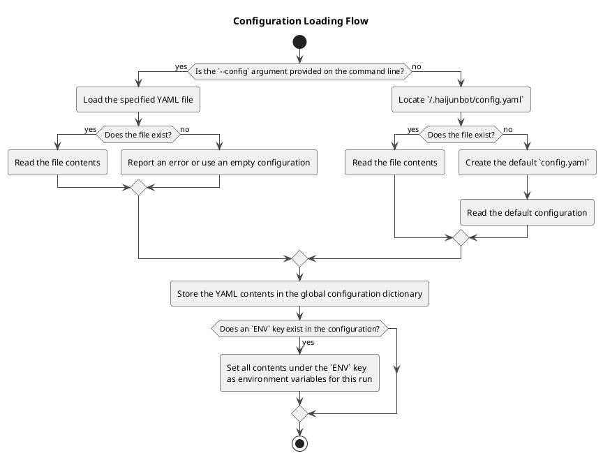
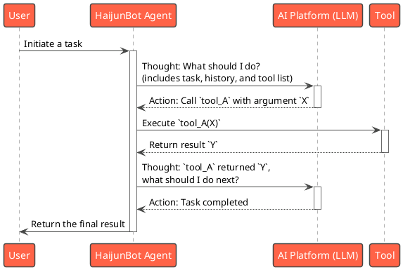
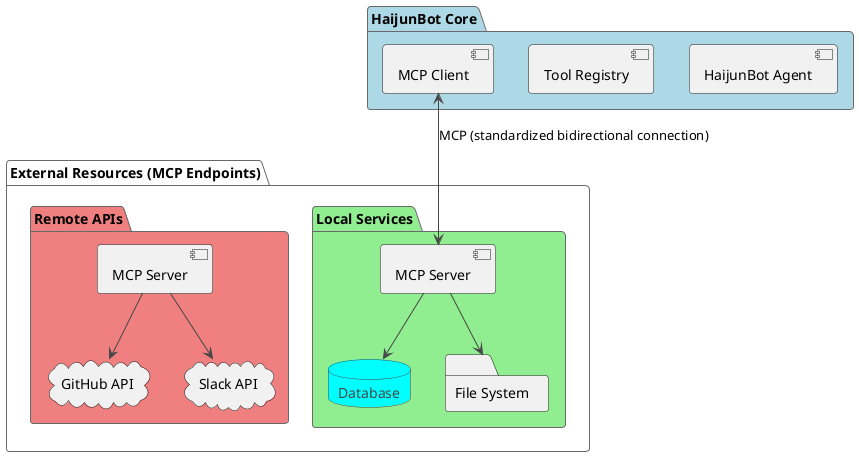
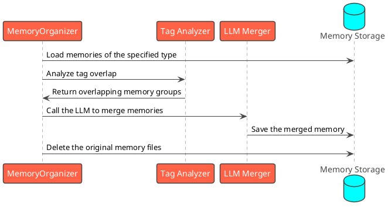
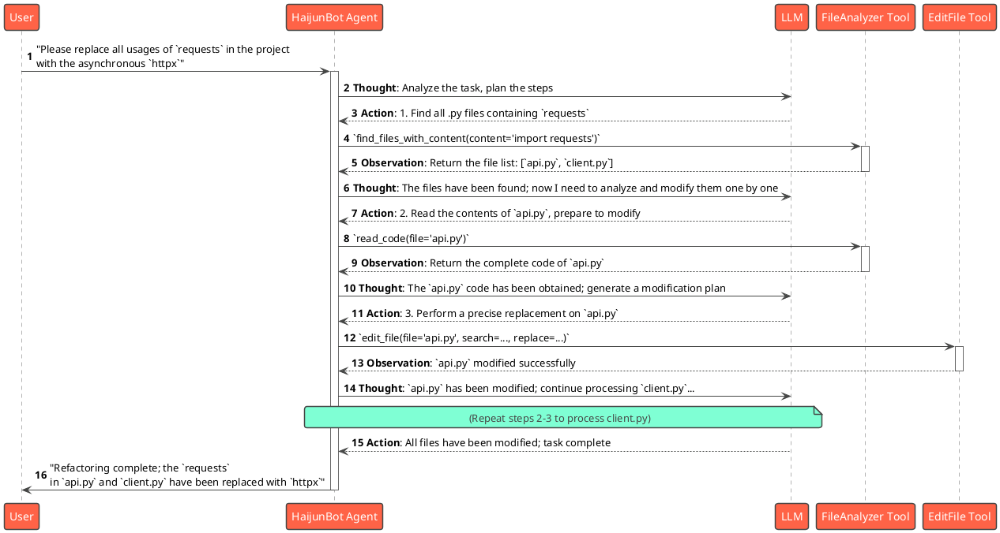

# 6. Advanced Topics

This chapter is intended for users who want to deeply customize and unlock the potential of HaijunBot, and introduces some advanced configurations and features.

## 6.1 LLM Group Configuration

```yaml
# 1. Define available LLM groups
llm_groups:
  # LLM group one: use a powerful combination of models
  power_group:
    normal_llm: openai-power
    cheap_llm: ollama-speed
    # Optional: configure a fallback model group; in non-interactive mode, automatically switches when this group's models fail consecutively
    fallback_group: speed_group
  # LLM group two: use a fast and economical combination of models
  speed_group:
    normal_llm: ollama-speed
    # If no thinking model is specified, the normal model will be used automatically
llms:
  openai-power:
    platform: openai
    model: gpt-4o
    max_input_token_count: 1280
  ollama-speed:
    platform: ollama
    model: llama3
# 2. Select the LLM group to activate
llm_group: power_group
```

### Fallback Model Group (fallback_group)

Each LLM group can specify a fallback model group via the optional `fallback_group` (its value must be a group name already defined in `llm_groups`). When the models of the current group **fail consecutively** (retries are exhausted and still return empty results), HaijunBot will automatically switch to the fallback group and retry once.

- **Only effective in non-interactive mode**: In interactive mode (such as a manual conversation), it will not switch automatically, to avoid interrupting the user's choice of model.
- **No switching when `fallback_group` is not configured**: When there is no fallback group, the original failure behavior is retained.
- **Switches only once**: If it still fails after switching, it will not continue switching to other groups, to avoid an infinite loop.
- The switch only affects the global `llm_group` and rebuilds the model instance (retaining the current conversation messages); subsequent conversations will continue to use the fallback group.

### LLM Group Configuration Priority

HaijunBot applies the model configuration in the following order (from high to low):

1. **Command-line arguments**: Arguments passed directly, which override all other settings.
2. **LLM group configuration**: The configuration selected by `llm_group`.
3. **Code defaults**: If none of the above are configured, the system's built-in default model is used.

---

## 6.2 Shortcut Directives

To improve interaction efficiency, HaijunBot supports two shortcut directive mechanisms: **meta-commands** and **input replacement mapping**. Both are processed by `input_handler` before the input is sent to the AI model.

### Meta-Commands

Meta-commands are special directives hard-coded in `builtin_input_handler`, used to perform system-level operations, and usually interrupt the normal AI interaction flow.

**Usage format**: Enter `'<command name>'` in the interactive interface, for example `'<Clear>'`.

| Meta-Command       | Function Description                     |
| ------------------ | --------------------------------------- |
| `'<Summary>'`      | Have the AI summarize the current session content and clear the history.  |
| `'<Clear>'`        | Force-clear the current session and start a brand-new conversation.  |
| `'<ToolUsage>'`    | Display all loaded available tools and their usage methods.  |
| `'<ReloadConfig>'` | Reload the `~/.haijunbot/config.yaml` file. |
| `'<SaveSession>'`  | Save the current session state to a file and exit the program immediately.  |

### Input Replacement Mapping (Replace Map)

This mechanism allows you to define some short tags; when these tags are entered, the system will automatically replace them with longer, preset template strings before handing them to the AI for processing. This is very suitable for solidifying some commonly used high-frequency directives.

**Usage format**: Enter `'<tag name>'` in the interactive interface, for example `'<Web>'`.

#### Built-in Replacement Directives

| Tag                   | Function Description                                            |
| ---------------------- | --------------------------------------------------- |
| `'<FindRelatedFiles>'` | Instruct the AI to find files related to the subsequent description in the current directory.          |
| `'<Dev>'`              | Instruct the AI to call `create_code_agent` to handle a development requirement. |
| `'<Fix>'`              | Instruct the AI to fix the problem mentioned in the subsequent description.                    |
| `'<Check>'`            | Instruct the AI to check the code using static analysis tools.                    |

#### Custom Replacement Directives

You can define your own shortcut directives in the configuration file `~/.haijunbot/config.yaml` via `replace_map`.

```yaml
# ~/.haijunbot/config.yaml
replace_map:
  my_check: # Define a shortcut directive named 'my_check'
    template: "Please use pylint to perform a code quality check on all python files under the src directory, and report the problems"
    description: "Run a custom pylint check"
    append: false # false means replace user input, true means append to user input
```

After configuration, when you enter `'<my_check>'` in `hjb`, it will be automatically replaced with the long directive in `template`.

---

## 6.3 Custom Agent (`haijunbot-agent` / `ha`)

Although preset agents such as `hjb` (HaijunBot) and `hca` (Code Agent) can satisfy most needs, sometimes you may need an agent with a specific "persona", a specific toolset, and a specific behavioral pattern. `haijunbot-agent` (`ha`) is the tool used to create and run this kind of highly customized agent.

### Agent Definition File

The core of a custom agent is a definition file in YAML format.

```yaml
# my_db_admin_agent.yaml

# The name of the agent
name: "Database Administrator"

# The system prompt, which defines the agent's identity and code of conduct
system_prompt: |
  You are a professional database administrator (DBA).
  Your responsibility is to help users manage databases.
  You may only use the provided `sql_query` and `db_schema` tools.
  Before performing any write operation (INSERT, UPDATE, DELETE), you must request confirmation from the user.

# Limit the list of tools available to this agent (optional)
# If not specified, the agent will be able to use all loaded tools
use_tools:
  - "sql_query"
  - "db_schema"

# Whether a summary needs to be generated after the task ends
need_summary: true

# (Optional) Whether to force a prompt for the user to save memory at key nodes.
# The default behavior is controlled by the global configuration `force_save_memory` (defaults to true).
# You can override that setting here:
#   - true: When the conversation history is too long or the task is completed, a memory save prompt will be triggered automatically.
#   - false: No automatic prompt, suitable for scenarios where memory does not need to be saved frequently or where manual control is preferred.
force_save_memory: false # Example: this agent will not automatically prompt to save memory
```

### Usage

You can use the `-c` or `--agent-definition` argument to load your agent definition file.

```bash
# Use a custom DBA agent and assign it an initial task
ha -c my_db_admin_agent.yaml -T "Query how many records are in the users table"
```

In this way, you can create all kinds of expert agents focused on specific domains, such as a "documentation writing expert", a "k8s operations expert", or a "security analysis expert", greatly expanding the application scenarios of HaijunBot.

---

---

## 6.4 Chat Role Presets (`hpm role`)

Unlike `ha` (custom agent), which focuses on executing complex tasks, sometimes you may just want to quickly have a pure conversation with an AI that has a specific "persona" and knowledge domain. The `hpm role` feature is designed for this.

It allows you to predefine a set of "chat roles", each bound to a specific model and system prompt, so that you can "play" experts in different domains for a conversation with a single command.

### Role Definition File (`roles.yaml`)

You need to create a `roles.yaml` file in the `~/.haijunbot/` directory (or specify another path via `hpm role -c`), and define your list of roles in it.

The file structure is as follows:

```yaml
# ~/.haijunbot/roles.yaml

roles:
  - name: "Senior Python Developer"
    description: "An expert focused on Python programming, code optimization, and architecture design."
    platform: "deepseek"
    model: "deepseek-coder"
    system_prompt: |
      You are a senior Python developer and architect with 20 years of experience.
      You can answer any question about Python, from basic syntax to advanced concurrent programming, asynchronous IO, metaclasses, and performance tuning.
      Your answers should be precise and in-depth, and should be accompanied by high-quality code examples.

  - name: "English Translation and Polishing Expert"
    description: "Proficient in Chinese-English mutual translation, skilled at providing idiomatic, professional translation and polishing suggestions."
    platform: "openai"
    model: "gpt-4o"
    system_prompt: |
      You are a professional English-Chinese translator and editor.
      Your task is to provide accurate, natural, and context-aware translations.
      When asked to polish text, you should explain your changes and offer alternative phrasings.

  - name: "Golang Concurrency Master"
    description: "Deeply understands Go's concurrency model and underlying principles."
    platform: "ollama"
    model: "gemma2"
    system_prompt: |
      You are a Golang concurrency master. You know goroutines, channels, select, and the sync package like the back of your hand.
      Your task is to help users understand and solve complex Go concurrency problems, and to provide robust, efficient concurrency code examples.
```

### Usage

1. **Start role selection**: Simply run the `hpm role` command.

   ```bash
   hpm role
   ```

2. **Select a role**: The program will list all roles defined in `roles.yaml`; you can enter a number to select one.

   ```text
   Available roles
   1. Senior Python Developer - An expert focused on Python programming, code optimization, and architecture design.
   2. English Translation and Polishing Expert - Proficient in Chinese-English mutual translation, skilled at providing idiomatic, professional translation and polishing suggestions.
   3. Golang Concurrency Master - Deeply understands Go's concurrency model and underlying principles.

   Please select a role (enter a number): 1
   ```

3. **Start the conversation**: After selecting, HaijunBot will load that role's model and system prompt, and then you can directly start a conversation with this "expert".

`hpm role` is a lightweight but very practical feature that lets you easily switch between different expert roles without having to manually set the system prompt and model every time.

### Other hpm Commands: info / chat / service

The platform manager also provides the ability to list platforms, chat directly, and start an OpenAI-compatible API service (provided by haijunbot_platform_manager.main):

- info: list the platforms and models corresponding to model groups
- chat: conduct an interactive chat with a specified model group
- service: start an OpenAI-compatible HTTP service

#### 1) hpm info

- Purpose: list the platforms corresponding to model groups and their available models.
- Syntax:
  - hpm info
  - hpm info -g `llm_group`
- Behavior description:
  - When `-g` is not specified, use the platform corresponding to the default model group and call get_model_list() to display the models and their descriptions.
  - When `-g` is specified, display the model list of the platform corresponding to that model group.
- Examples:
  - hpm info
  - hpm info -g power_group

#### 2) hpm chat

- Purpose: conduct an interactive chat using a specified model group, supporting various session management commands.
- Syntax:
  - hpm chat [-g/--llm-group `group`]
- Parameter priority:
  1. Command-line argument -g/--llm-group
  2. Global default configuration (when llm_group is not specified, use get_normal_platform_name() / get_normal_model_name())
- Interactive commands:
  - /bye: exit
  - /clear: clear the platform session (reset) and reset the model; clear the local conversation history
  - /upload `path`: upload a file (requires platform support; calls platform.support_upload_files and upload_files)
  - /save `file`: save the last assistant reply to a file
  - /saveall `file`: save the complete conversation to a file (role: content)
  - /save_session `file`: call platform.save to persist the current session
  - /load_session `file`: call platform.restore to restore the session; the local history will be cleared
  - /shell `command`: execute a command in the local shell (use with caution)
- Examples:
  - hpm chat
  - hpm chat -g power_group
- Notes:
  - When an exception occurs, an error prompt will be shown; before the session ends, it attempts to call platform.reset for cleanup.

#### 3) hpm service (OpenAI-compatible API)

- Purpose: start an OpenAI-compatible REST service, supporting /v1/models and /v1/chat/completions.
- Syntax:
  - hpm service [--host 0.0.0.0] [--port 8000]
- Endpoints and behavior:
  - GET /v1/models
    - Lists the models for the current default platform (determined by the default model group in the configuration), returning an OpenAI-style model list (with id being platform/model).
  - POST /v1/chat/completions
    - Request body (main fields): model, messages ([{role, content}]), stream (optional)
    - model can be "platform/model"; if only "model" is provided, the default platform is used, otherwise a 400 is returned.
    - Non-streaming: returns standard OpenAI chat.completion JSON.
    - Streaming: returns text/event-stream (SSE), outputting progressively as chat.completion.chunk fragments, ending with [DONE].
- Logs:
  - Preferentially written to the directory specified by the environment variable `HAIJUNBOT_LOG_DIR` (environment variables still use uppercase); otherwise written to ~/.haijunbot/logs; if that fails, fall back to ./logs.
  - Each session is recorded as plain text, including message and model information.
- CORS:
  - CORS is enabled: allows any origin (suitable for development/testing).
- Examples:
  - Start the service:
    - hpm service --host 0.0.0.0 --port 8000
  - Non-streaming request:

    ```bash
    curl -X POST http://127.0.0.1:8000/v1/chat/completions \
      -H "Content-Type: application/json" \
      -d '{"model":"openai/gpt-4o","messages":[{"role":"user","content":"hello"}]}'
    ```

  - Streaming request:

    ```bash
    curl -N -X POST http://127.0.0.1:8000/v1/chat/completions \
      -H "Content-Type: application/json" \
      -d '{"model":"openai/gpt-4o","stream":true,"messages":[{"role":"user","content":"streaming test"}]}'
    ```

---

## 6.5 Methodology Sharing and Extension

In addition to tasks and agents defined on the fly, HaijunBot also supports a more advanced concept: **Methodology**. A methodology is a reusable, structured advanced problem-solving solution that can be preserved, shared with a team, and automatically invoked by the AI in appropriate scenarios, thereby greatly improving the efficiency and quality of solving specific types of problems.

### What Is a Methodology?

Simply put, a methodology is an "operation manual" or "best-practice guide" for a specific "problem type". When the requirement entered by the user matches a certain methodology's "problem type", the AI will preferentially refer to this guide to plan its course of action.

### The Format of a Methodology

A methodology exists as a simple JSON file, with each file defining one methodology.

**Core fields**:

- `problem_type`: (string) A concise description of the type of problem this methodology solves. This is the key used by the AI to match user requirements.
- `content`: (string) The specific content of the methodology, i.e., the detailed steps, principles, and suggestions.

**Example: `code_review_methodology.json`**

```json
{
  "problem_type": "Code review and refactoring",
  "content": "When performing a code review or refactoring, please follow these steps:\n1. **Understand the business context**: First, use read_code and conversation with the user to fully understand the business logic and goals of the relevant code.\n2. **Static analysis**: Run static code analysis tools (such as pylint, go vet) to find potential low-level errors and non-standard coding practices.\n3. **Readability first**: Check the readability of the code, including whether naming is clear, whether comments are sufficient, and whether the responsibilities of functions and classes are single.\n4. **Identify bad smells**: Look for common code smells, such as overly long functions, duplicated code, and excessively deep nesting.\n5. **Propose concrete suggestions**: Don't just say \"the code needs optimization\"; rather, propose concrete, actionable modification suggestions and explain why such modifications would be better.\n6. **Commit in small steps**: If refactoring, it is recommended to break large changes into a series of small, independent modifications, and generate a clear commit message for each step."
}
```

### Loading and Sharing

HaijunBot automatically loads all methodology files in `.json` format from the following locations:

1. **User methodology directory**: `~/.haijunbot/methodologies/` (the recommended place to store your personal methodologies)
2. **External methodology directories**: The list of directories specified by the `methodology_dirs` configuration.

**Sharing Methodologies via Git**:

The original design intent of `methodology_dirs` is to facilitate team collaboration and knowledge sharing. You can:

1. Create a Git repository specifically for storing the team's best practices and methodologies (`.json` files).
2. Have team members clone this repository locally.
3. Set the `methodology_dirs` configuration to point to the local path of that repository.

```bash
# For example, clone the team's methodology repository to ~/git/team-methodologies
git clone https://github.com/your-org/team-methodologies.git ~/git/team-methodologies

# Set in ~/.haijunbot/config.yaml
methodology_dirs:
  - "~/git/team-methodologies"
```

After configuration is complete, HaijunBot will automatically load all methodologies from this Git repository on startup. Even better, HaijunBot has a built-in **daily automatic update** mechanism, which automatically pulls the latest methodologies, ensuring that the entire team's knowledge base stays in sync.

In this way, you can crystallize the team's wisdom into executable "digital assets", allowing the AI assistant to continuously learn and grow, and to become an increasingly capable expert within the team.

---

## 6.6 Central Methodology Repository

In addition to local and team-shared methodology directories, HaijunBot also supports the concept of a **central methodology repository**. This is a centralized methodology repository maintained by a community or organization, which can serve as an authoritative source of best practices.

### Configuring the Central Methodology Repository

Specify the Git repository address by setting the `central_methodology_repo` configuration:

```yaml
# ~/.haijunbot/config.yaml
central_methodology_repo: "https://github.com/your-org/haijunbot-methodologies.git"
```

### How It Works

1. **Automatic cloning**: On the first run, HaijunBot will automatically clone the central methodology repository locally (`~/.haijunbot/central_methodology_repo/`)
2. **Daily update**: HaijunBot has a built-in automatic update mechanism, which automatically pulls the latest methodologies on the first startup each day
3. **Highest priority**: The central methodology repository takes priority over local and team methodologies, ensuring the use of the latest best practices

### Sharing Methodologies to the Central Repository

If you have developed an excellent methodology, you can share it to the central repository via the following command:

```bash
# Share a local methodology to the central repository
hjb --share-methodology
```

This command will:

1. List all local methodology files
2. Allow you to select the methodology to share
3. Automatically detect duplicate content to avoid redundancy
4. Copy the selected methodology to the central repository and push it

### Use Cases

- **Organizational standardization**: Large organizations can maintain a unified methodology repository to ensure that all teams follow the same best practices
- **Community collaboration**: Open-source communities can jointly maintain and improve methodologies, forming collective intelligence
- **Knowledge transfer**: Solidify expert experience into methodologies, so that new members can quickly learn and apply it

---

## 6.7 Central Tool Repository

Similar to the central methodology repository, HaijunBot also supports a **central tool repository**, allowing a team or community to share custom tools and expand the boundaries of HaijunBot's capabilities.

### Configuring the Central Tool Repository

Specify it by setting the `central_tool_repo` configuration:

```yaml
# ~/.haijunbot/config.yaml
central_tool_repo: "https://github.com/your-org/haijunbot-tools.git"
```

### How It Works

1. **Automatic cloning**: Once configured, HaijunBot will automatically clone the central tool repository locally (`~/.haijunbot/central_tool_repo/`)
2. **Daily update**: Like the methodology repository, the tool repository is also automatically updated daily
3. **Tool loading order**:
   - Built-in tools (lowest priority)
   - Local tools (`~/.haijunbot/tools/`)
   - Tools from externally configured directories
   - Central tool repository (highest priority)
4. **Override mechanism**: Tools with the same name are overridden by the later-loaded version; tools from the central repository have the highest priority

### Sharing Tools to the Central Repository

You can share locally developed tools to the central repository:

```bash
# Share a local tool to the central repository
hjb --share-tool
```

**Notes**:

- Tool sharing uses **move** rather than copy; the original file will be deleted
- Only tools in the `tools/` directory under the data directory can be shared
- The system automatically detects and excludes tools that already exist

### Tool Development Guidelines

Tools in the central tool repository should follow these guidelines:

1. **Clear documentation**: Each tool should include a detailed functional description and parameter documentation
2. **Error handling**: Properly handle various exceptional situations and provide meaningful error messages
3. **Dependency management**: Explicitly declare external dependencies to avoid runtime errors
4. **Naming conventions**: Use descriptive tool names to avoid conflicts with existing tools

### Use Cases

- **Domain-specific tools**: Develop dedicated tool sets for specific domains (such as database management, cloud service operations)
- **Enterprise internal tools**: Integrate enterprise internal systems and APIs to expand HaijunBot's enterprise application capabilities
- **Efficiency tools**: Encapsulate commonly used complex operations as simple tools to improve team efficiency
- **Standardized operations**: Ensure the team uses a unified tool version and implementation

### Best Practices

1. **Version control**: Use Git tags to manage tool versions, making rollback and tracking easier
2. **Test coverage**: Write unit tests for tools to ensure stability
3. **Backward compatibility**: Keep the API compatible when updating tools, to avoid breaking existing usage
4. **Security review**: Regularly review tool code to ensure there are no security risks

---

## 6.8 Tool Group Configuration

In different task scenarios, you may need to enable or disable specific tool sets. For example, disable network-related tools when handling sensitive data, or use only certain dedicated tools in a specific project. The **Tool Group** feature allows you to predefine different tool configuration sets and quickly switch between them when needed.

### Configuration Method

In your global configuration file `~/.haijunbot/config.yaml`, you can define a `tool_groups` list and use `tool_group` to select the currently active group.

```yaml
# 1. Define available tool groups
tool_groups:
  # Tool group one: use only local development tools
  - local_dev:
      use:
        - execute_script
        - read_code
        - rewrite_file
        - save_memory
        - retrieve_memory
      dont_use:

  # Tool group two: data analysis tool set
  - data_analysis:
      use:
        - execute_script
        - read_code
        - rewrite_file # Prohibit file modification
        - save_memory # Prohibit saving memory

  # Tool group three: safe mode (minimal tool set)
  - safe_mode:
      use:
        - read_code
      dont_use: [] # All other tools will be disabled

# 2. Select the tool group to activate
tool_group: local_dev
```

### Tool Group Configuration Description

Each tool group can contain two configuration items:

- **`use`**: Explicitly specify the list of tools to enable. If this list is specified, only the tools in the list will be loaded.
- **`dont_use`**: Explicitly specify the list of tools to disable. These tools will be excluded even if they are in the `use` list.

### Tool Group Configuration Priority

The tool group configuration takes effect in the following priority order:

1. **Command-line arguments**: The tool group specified with the `--tool-group` argument
2. **Configuration**: The `tool_group` configuration
3. **Configuration file**: The `tool_group` setting in the configuration file
4. **Default behavior**: If no tool group is specified, all available tools are loaded

### Usage Examples

1. **Switching tool groups via command-line arguments**:

   ```bash
   # Run with the safe mode tool group
   hjb --tool-group safe_mode -t "Analyze this code file"

   # Use the data analysis tool group
   ha --tool-group data_analysis -t "Search for and analyze the latest machine learning trends"
   ```

2. **Setting via configuration**:

   ```bash
   # Temporarily switch to safe mode (set in ~/.haijunbot/config.yaml)
   # tool_group: safe_mode
   hjb -G safe_mode
   ```

3. **Dynamically switching tool groups**:
   You can also switch tool groups at runtime by modifying the configuration file and using the `'<ReloadConfig>'` meta-command.

### Practical Scenarios

1. **Development environment isolation**: Configure different tool sets for different projects to avoid misoperations
2. **Security compliance**: Limit the scope of tool usage when handling sensitive data
3. **Performance optimization**: Reduce unnecessary tool loading to improve startup speed
4. **Permission control**: Provide different levels of tool access permissions for different users or scenarios

## 6.9 Post-Tool-Call Callback Extension (after_tool_call_cb)

To insert custom logic after each tool execution (such as logging, statistics, secondary processing, etc.), HaijunBot has enhanced the capabilities of after_tool_call_cb:

- Support for multiple callbacks: Agent.after_tool_call_cb has been upgraded from a single callback to a callback list, executed in sequence
- Dynamic registration: .py files can be scanned from configured directories and callbacks dynamically loaded by convention, without modifying the core code

### 6.9.1 Usage Overview

- Code registration: subscribe to a callback at runtime via `agent.event_bus.subscribe(AFTER_TOOL_CALL, cb)` (the same callback will not be added twice)
- Configuration registration: specify `after_tool_call_cb_dirs` in the configuration file, and the Agent will automatically scan and register them at startup

```yaml
# ~/.haijunbot/config.yaml
after_tool_call_cb_dirs:
  - "~/haijunbot_callbacks"
  - "$WORKSPACE/custom_cbs"
```

Paths support ~ expansion and environment variable expansion.

### 6.9.2 Conventions for Dynamic Registration

The system will scan all .py files in the directories specified by `after_tool_call_cb_dirs` (ignoring **init**.py), and attempt to register them in sequence according to the following conventions:

1. Module-level callable object

- Name: after_tool_call_cb
- Signature: accepts keyword arguments (including agent), i.e., `def after_tool_call_cb(**kwargs)`

1. Factory function get_after_tool_call_cb()

- Returns a single callback or a list of callbacks
- Signature: () -> Callable or List[Callable]

1. Factory function register_after_tool_call_cb()

- Returns a single callback or a list of callbacks
- Signature: () -> Callable or List[Callable]

Notes:

- To avoid polluting sys.path, the import process only temporarily inserts the directory containing the file, and removes it when done
- The same callback will not be added twice
- The header of a callback file can declare dependencies with `# requirements: pkg1 pkg2`, which will be automatically installed when loading

### 6.9.3 Execution Timing and Order

- Execution timing: After each tool call completes, the subscribed callbacks are invoked in sequence first, and then the AFTER_TOOL_CALL event is broadcast
- Execution order: According to the scan order (directory and file iteration order) and the order in which they are discovered in the module
- Failure isolation: An exception in a single callback will not interrupt the main flow (the exception is caught and ignored)

### 6.9.4 Code Examples

The simplest module-level callback (file name for example my_cb.py):

```python
# my_cb.py
def after_tool_call_cb(**kwargs):
    agent = kwargs.get("agent")
    # Read the name of the last executed tool (recorded by ToolRegistry)
    last_tool = agent.get_user_data("__last_executed_tool__")
    from haijunbot.haijunbot_utils.output import PrettyOutput, OutputType
    PrettyOutput.print(f"Tool execution completed: {last_tool}", OutputType.INFO)
```

Using a factory function to return multiple callbacks:

```python
# multi_cb.py
def _log_cb(**kwargs):
    from haijunbot.haijunbot_utils.output import PrettyOutput, OutputType
    PrettyOutput.print("Execution log callback", OutputType.INFO)

def _metrics_cb(**kwargs):
    # Custom statistics logic
    pass

def get_after_tool_call_cb():
    # Can return a list
    return [_log_cb, _metrics_cb]
```

Or register manually (in custom code):

```python
# After obtaining the agent instance
from haijunbot.haijunbot_agent.events import AFTER_TOOL_CALL

def my_cb(**kwargs):
    agent = kwargs.get("agent")
    print("after tool call!")

agent.event_bus.subscribe(AFTER_TOOL_CALL, my_cb)
```

### 6.9.5 Relationship with the Existing Event System

- after_tool_call_cb is a lightweight hook, suitable for injecting local logic
- If you need more general event subscription, please preferentially consider using EventBus (BEFORE_TOOL_CALL, AFTER_TOOL_CALL, etc.)

## 6.10 Configuration System in Detail

HaijunBot's configuration system (`src/haijunbot/haijunbot_utils/config.py`) is designed to be very straightforward, to ensure a single source and predictability of configuration.

### 6.10.1 Configuration Loading Mechanism

At runtime, HaijunBot loads all configuration from only **one** YAML file. The rules for determining that file are as follows:

1. **Specified on the command line (highest priority)**: The user can explicitly specify the configuration file used for this run via the `--config <path/to/your_config.yaml>` argument when starting the command.
2. **Default user configuration**: If not specified on the command line, the system will automatically look for and load the `~/.haijunbot/config.yaml` file located in the user's home directory.



All configuration items loaded from this file are stored in a global dictionary, and are accessed at runtime through the `get_*` functions in `config.py`. This design avoids the complexity and uncertainty brought by multi-layer configuration overriding.

### 6.10.2 Reference of Key Configuration Items

The following are the main configuration items supported in the `config.yaml` file and their descriptions:

| Configuration Item (Key)   | Description                                                                                                                                                                                      | Default Value  |
| -------------------------- | ----------------------------------------------------------------------------------------------------------------------------------------------------------------------------------------- | ------- |
| `llm_group`                | The name of the currently active model group.                                                                                                                                                                    | `""`    |
| `llms`                     | Reusable LLM configuration definitions (platform, model, max input token, etc.), which can be referenced by name in `llm_groups`.                                                                                                  | `{}`    |
| `llm_groups`               | Predefined model configuration groups, referencing configurations in `llms` via `normal_llm`/`cheap_llm`/`smart_llm`/`eval_llm`. Each group can optionally use `fallback_group` to specify a fallback group (automatically switches on consecutive failures in non-interactive mode).                                                                                           | `{}`    |
| `execute_tool_confirm`     | Whether secondary confirmation from the user is required before executing any tool.                                                                                                                                                    | `false` |
| `methodology_dirs`         | A list of additional methodology loading directories.                                                                                                                                                                | `[]`    |
| `central_methodology_repo` | The Git repository address of the central methodology repository, used for team sharing of methodologies.                                                                                                                                             | `""`    |
| `central_tool_repo`        | The address of the central tool repository, used for team sharing of custom tools.                                                                                                                                                | `""`    |
| `central_rules_repo`       | The address of the central rules repository, used for team sharing of rules.                                                                                                                                                      | `""`    |
| `print_prompt`             | Whether to print the complete prompt sent to the LLM in the console, for debugging.                                                                                                                                         | `false` |
| `git_commit_prompt`        | The custom template used by the `hgc` command when generating a Git Commit Message.                                                                                                                                    | `""`    |
| `replace_map`              | Defines custom shortcut command replacement rules used during interaction.                                                                                                                                                | `{}`    |
| `mcp`                      | A list used to define endpoint configurations for all Model Context Protocol (MCP) endpoints. Supports three types: `stdio` (local command-line program), `sse` (Server-Sent Events remote service), `streamable` (streamable HTTP service). See the MCP configuration chapter for details. | `[]`    |
| `tool_group`               | The name of the currently active tool group (see the tool group configuration chapter for details).                                                                                                                                              | `""`    |
| `tool_groups`              | A list of predefined tool groups (see the tool group configuration chapter for details).                                                                                                                                                | `[]`    |
| `tool_load_dirs`           | A list of loading directories for custom tools.                                                                                                                                                                | `[]`    |
| `after_tool_call_cb_dirs`  | A list of scan directories for post-tool-call callbacks (see section 6.10 for details).                                                                                                                                            | `[]`    |
| `enable_tmux`              | Whether to enable tmux functionality. When set to `true`, the system will enable tmux-related features, including automatically starting a tmux session and dispatching tasks to tmux windows, etc.                                                                        | `false` |
| `enable_native_tool_calls` | Whether to enable the native tool calling (function calling) protocol.                                                                                                                                            | `true`  |
| `save_session_history`     | Whether to save session records.                                                                                                                                                                        | `false` |
| `auto_resume_session`      | Whether to automatically resume the last session.                                                                                                                                                                    | `false` |
| `ENV`                      | A dictionary used to set temporary environment variables for the HaijunBot runtime environment.                                                                                                                                      | `{}`    |

> For a complete and always up-to-date list of configuration items, please refer to `src/haijunbot/haijunbot_data/config_schema.json`.

## 6.11 Data Flow and the "Thought-Action" Loop

At the core of HaijunBot is a loop called "Thought-Action", which drives the entire task execution process.



1. **Thought**: The Agent packages the current task, conversation history, and list of available tools into a prompt and sends it to the LLM.
2. **Action**: The LLM returns a structured response, which contains the name of the tool to call and the required arguments.
3. **Observation**: The Agent parses the response, calls the specified tool, and captures its output.
4. **Loop**: The tool's output (the observation result) is added to the conversation history, and then the loop returns to the first step to begin a new "thought" process.

This loop repeats continuously until the LLM determines that the task has been completed.

## 6.12 Model Context Protocol (MCP): The USB-C of AI Applications

HaijunBot's extreme extensibility is largely due to its support for the **Model Context Protocol (MCP)**. MCP is an open protocol advocated by companies such as Juglow, aimed at standardizing the way applications provide context information to large language models (LLMs). You can vividly understand it as the **"USB-C port for AI applications"**.

### 6.12.1 Design Philosophy

Just as USB-C provides a standardized physical interface to connect various peripherals, MCP provides a standardized software interface that allows AI models to securely and efficiently connect to various external data sources and tools. Whether it is a local file system or database, or a remote GitHub API or Slack service, all can provide capabilities to HaijunBot through this "universal socket" of MCP, thereby greatly simplifying the complexity of integration.

### 6.12.2 Architecture Diagram



### 6.12.3 Core Advantages

- **Simplified development**: Developers do not need to write custom integration code for each new tool or data source. They only need to make their service follow the MCP specification, and HaijunBot can automatically discover and use it.
- **Security and compliance**: MCP takes security issues into account in its design, providing a secure and controllable channel for data exchange between models and external tools.
- **Real-time and bidirectional**: The protocol supports real-time, bidirectional communication, enabling HaijunBot not only to call tools but also to subscribe to events and updates from external services.
- **Decentralization**: It promotes the standardization and decentralization of AI applications; any service that follows the protocol can become part of the ecosystem.

### 6.12.4 Workflow

1. **Service discovery**: When HaijunBot starts, `ToolRegistry` connects to the specified MCP endpoints (Endpoint) according to the configuration (`mcp`).
2. **Capability declaration**: According to the protocol, MCP endpoints declare to HaijunBot all the capabilities they can provide (i.e., "tools"), including the name, functional description, and parameter schema (Schema) of each tool.
3. **Dynamic registration**: `ToolRegistry` receives these declarations and dynamically registers them as tools available internally to HaijunBot. From the perspective of `Agent`, these external tools are indistinguishable in use from Python built-in tools.
4. **Standardized invocation**: When `Agent` decides to call an MCP tool, `MCP Client` packages the request according to the protocol specification and sends it to the corresponding MCP endpoint. After the endpoint performs the corresponding operation, it returns the result in the standardized format.

### 6.12.5 Configuration Examples

HaijunBot supports three types of MCP clients:

**1. stdio type (local command-line program)**:

```yaml
mcp:
  - type: "stdio"
    name: "my_cli_tools"
    command: "/path/to/your/tool_program"
    args: ["--json-rpc", "--verbose"]
    env:
      CUSTOM_VAR: "value"
    enable: true
```

**2. sse type (Server-Sent Events remote service)**:

```yaml
mcp:
  - type: "sse"
    name: "realtime_service"
    base_url: "https://api.example.com/mcp"
    auth_token: "your-secret-token"
    headers:
      X-Custom-Header: "value"
    enable: true
```

**3. streamable type (streamable HTTP service)**:

```yaml
mcp:
  - type: "streamable"
    name: "large_file_processor"
    base_url: "https://stream.example.com/api"
    auth_token: "your-secret-token"
    endpoint_path: "mcp" # Optional, defaults to "mcp"
    timeout: [10, 300] # Optional, [connection timeout, read timeout] seconds
    enable: true
```

**Configuration Description**:

- All types must include the `type` field
- The `name` field is optional, but it is recommended to specify a unique name for each configuration
- The `enable` field is optional and defaults to `true`
- **sse/streamable types**: `base_url` must be provided; `auth_token`, `headers`, `endpoint_path` (streamable only), `timeout` (streamable only) are optional
- **stdio type**: `command` must be provided; `args`, `env` are optional

By embracing MCP, HaijunBot breaks the boundaries of its own capabilities, allowing it to easily and securely integrate into any existing IT environment, and to use endless external data and services to accomplish more complex tasks.

## 6.13 Memory Organization Mechanism and Implementation Principles

During long-term use of HaijunBot, the system accumulates a large amount of memory, which includes duplicate or highly similar content. To optimize storage efficiency and improve retrieval quality, HaijunBot provides a dedicated memory organization tool `haijunbot-memory-organizer`, used to automatically identify and merge memories with similar tags.

### 6.13.1 Core Design Philosophy

The core idea of memory organization is: **analyze tag similarity to merge duplicate or related memories into a single, comprehensive memory**. This process is based on the following principles:

- **Tag-driven**: Use tags as the primary basis for judging memory similarity
- **Intelligent merging**: Use a large language model (LLM) for semantic integration to ensure information completeness
- **Progressive processing**: From highly overlapping to lightly overlapping, gradually clean up redundancy
- **Safe and controllable**: Provide a dry-run mode, allowing users to preview the results of operations

### 6.13.2 Implementation Architecture



### 6.13.3 Algorithm Flow in Detail

1. **Data loading phase**
   - Scan the project-level (`.haijunbot/memory/`) and global-level (`~/.haijunbot/memory/`) memory directories
   - Load all memory files in JSON format
   - Build an inverted index from tags to memories

2. **Similarity detection**
   - Use combinatorics to calculate the tag overlap of all memory pairs
   - Use a greedy algorithm to expand memory groups, ensuring that every pair of memories in a group has at least 2 overlapping tags (the current implementation is fixed at 2)

3. **Intelligent merging**
   - Arrange the memories to be merged in reverse chronological order (newest first)
   - Use a specific prompt to guide the LLM in content integration:
     - Identify common themes and key information
     - Retain key details from the newest memory
     - Generate a new, more precise set of tags
   - Output the merge result in structured YAML format

4. **Atomic operations**
   - Create a new memory file (with the merged\_ prefix)
   - Delete the original memory files
   - Record the merge source to maintain data traceability

### 6.13.4 Usage Examples

```bash
# Organize project long-term memory
haijunbot-memory-organizer organize --type project_long_term

# Simulate a run, previewing the merges that will be performed
haijunbot-memory-organizer organize --type global_long_term --dry-run

# Export memories of a specific type to a file
haijunbot-memory-organizer export memories.json --type project_long_term

# Import memories from a file
haijunbot-memory-organizer import backups/memories.json --overwrite
```

### 6.13.5 Performance Optimization Strategies

- **Fixed threshold**: The current implementation fixedly uses 2 overlapping tags as the merge threshold, to avoid over-merging
- **Deduplication mechanism**: Use ordered tuples to ensure the same group of memories is processed only once
- **Error isolation**: The failure of a single group merge does not affect the processing of other groups
- **Memory optimization**: Stream the processing of large model responses, to avoid memory overflow

## 6.14 Distributed Gateway Deployment

HaijunBot supports a distributed gateway deployment mode, allowing you to deploy the Web Gateway on multiple machines and access the Agents on all nodes through a unified entry point. This mode is particularly suitable for scenarios that require utilizing multi-machine resources, remote collaboration, or load sharing.

### 6.14.1 Architecture Overview

The distributed gateway adopts a master-slave architecture:

- **Master node (Master)**: Provides a unified external access entry point, and maintains the registration information of all child nodes
- **Child node (Child)**: Connects to the master node via a WebSocket long connection, and actually carries the running of the Agent
- **Client**: Only needs to connect to the master node; the master node automatically forwards requests to the corresponding child node

```text
┌─────────────┐     ┌─────────────┐     ┌─────────────┐
│  Web Browser  │     │  Other Clients  │
└──────┬──────┘     └──────┬──────┘
       └───────────────────┘
                           │
                           ▼
                  ┌─────────────────┐
                  │   Master Node (Master) │
                  └────────┬────────┘
                           │
           ┌───────────────┼───────────────┐
           ▼               ▼               ▼
    ┌─────────────┐ ┌─────────────┐ ┌─────────────┐
    │  Child Node 1    │ │  Child Node 2    │ │  Child Node N    │
    └─────────────┘ └─────────────┘ └─────────────┘
```

### 6.14.2 Quick Deployment

**Start the master node**:

```bash
haijunbot-service run --node-mode master --gateway-host 0.0.0.0 --gateway-port 8000
```

**Start a child node**:

```bash
haijunbot-service run --node-mode child \
    --node-id worker-01 \
    --master-url ws://master-host:8000 \
    --node-secret your_secret_key
```

### 6.14.3 Core Concepts

- **Node mode (`--node-mode`)**: `master` means master node, `child` means child node
- **Node ID (`--node-id`)**: The unique identifier of a child node, used to specify the target node when creating an Agent
- **Master node address (`--master-url`)**: The WebSocket address through which a child node connects to the master node
- **Node secret (`--node-secret`)**: Used for security verification of communication between nodes

### 6.14.4 Use Cases

1. **Multi-machine resource utilization**: Distribute compute-intensive tasks across multiple high-performance machines
2. **Team collaboration**: Team members access a unified HaijunBot service entry point from different locations
3. **Environment isolation**: Different child nodes can be configured with different runtime environments (such as different Python versions, tool sets)
4. **Load sharing**: Allocate different numbers of Agents based on machine performance

### 6.14.5 Production Environment Deployment Recommendations

For production environments, it is recommended to deploy using systemd or Docker Compose:

#### Using the install command to automatically install a systemd service

HaijunBot provides a convenient `install` command to automatically create and install a systemd user service:

**Install a user-level service**:

```bash
# Install as a systemd user service (recommended)
haijunbot-service install --node-mode master --gateway-host 0.0.0.0 --gateway-port 8000
```

**Service management commands**:

```bash
# Reload the systemd configuration
systemctl --user daemon-reload

# Enable the service (start on boot)
systemctl --user enable haijunbot-master.service

# Start the service
systemctl --user start haijunbot-master.service

# Check the service status
systemctl --user status haijunbot-master.service
```

**Advantages**:

- Automatically generates the correct systemd service file
- No need to manually write complex configuration files
- Supports configuration of all startup arguments
- Automatically handles dependency relationships and restart policies

#### Docker Compose Deployment

For containerized deployment, you can use Docker Compose:

```yaml
version: "3.8"
services:
  haijunbot-master:
    image: your-haijunbot-image
    command: run --node-mode master --gateway-host 0.0.0.0 --gateway-port 8000
    environment:
      - HAIJUNBOT_NODE_SECRET=your_secret
    ports:
      - "8000:8000"
    restart: unless-stopped
```

For more detailed deployment methods, please refer to [Distributed Gateway Deployment Method](../user-manual/04_web-ui-and-gateway/Distributed_Gateway_Deployment_Method.md).

## 6.15 Typical Application Scenario

To understand HaijunBot's working mode more intuitively, let's look at a concrete application scenario: **automated code refactoring**.

**Goal**: The user wants to replace all uses of the `requests` library in a Python project with the `httpx` library, and switch to asynchronous calls.

### Workflow Diagram



### Step Breakdown

1. **Task initiation**: The user presents a high-level, vague requirement to HaijunBot.
2. **Initial planning**: `Agent` sends the user's requirement and its own tool capabilities (especially the file analysis and editing tools) to `LLM`. The LLM understands that this is a multi-step code modification task and formulates the first concrete action: find all relevant files.
3. **File discovery**: `Agent` calls the `FileAnalyzer` tool (a hypothetical composite tool or a wrapper around `execute_script`) to scan the project and find all Python files that import the `requests` library. The observation result is a file list.
4. **Iterative processing**: `Agent` takes the file list as new context and requests `LLM` to plan again. The LLM decides to process the files one by one, and instructs `Agent` to first read the contents of the first file.
5. **Code analysis and patch generation**: After `Agent` obtains the file contents, it hands them to `LLM` for in-depth analysis. At this point, the LLM's core task is to generate a precise "patch" (Search & Replace) that can be used for find-and-replace. This is the key step in converting natural-language requirements into machine-executable operations.
6. **Precise execution**: `Agent` calls the `EditFile` tool, using the "patch" generated by the LLM to modify the file. Due to the determinism of the `EditFile` tool, the code modification is precise and reliable.
7. **Loop and completion**: `Agent` takes the successful modification result as context and continues to request the next step from `LLM`. The LLM will instruct it to process the next file in the list. When all files have been processed, the LLM will issue an instruction that the task is complete.
8. **Result reporting**: `Agent` reports to the user that the task has been successfully completed.

This scenario perfectly embodies HaijunBot's design philosophy: the LLM is responsible for "coming up with ideas and setting strategy", while reliable tools are responsible for "doing the dirty work and the detailed work"; the combination of the two completes complex development tasks efficiently and reliably.
