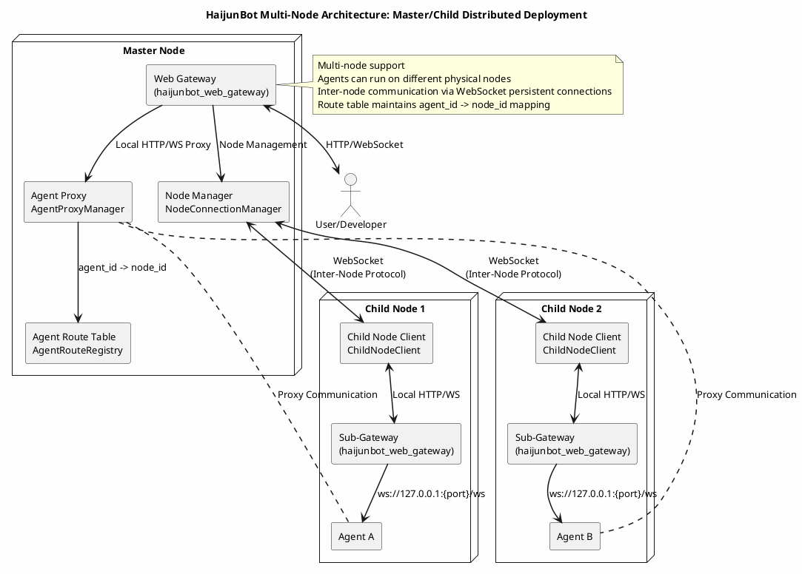
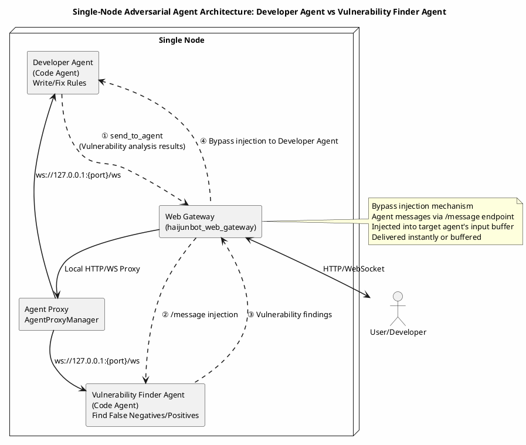

# Adversarial Agent Methodology for Optimizing Expert Systems

**Abstract**: This paper proposes an adversarial agent methodology where two agents with opposing roles engage in iterative adversarial interactions, gradually consolidating the generalization capabilities of large language models into the deterministic rules of expert systems to achieve a fusion of the advantages of both paradigms. Taking the security scanning module hsec on the HaijunBot platform as a case study, it demonstrates a 2-day adversarial evolution process in which 62 C/C++ detection rules evolved from regex-driven to database-driven architecture, ultimately achieving full detection of 154 vulnerability samples with zero false positives on 110 safe samples. The core characteristic of this approach is the gradual consolidation of the model's uncertain capabilities into deterministic rules of expert systems, making it applicable to hybrid scenarios of expert systems and agents such as fault localization and expert O&M.

## 1. Introduction

In software engineering and system security, there is a long-standing contradiction: **deterministic systems lack generalization capability, while systems with generalization capability lack determinism**.

Traditional expert systems operate based on predefined rules, producing deterministic outputs with high execution efficiency, but they can only handle scenarios covered by those rules. Once encountering new patterns not covered by rules, the system becomes ineffective. In recent years, large language models (LLMs) and agent technologies have demonstrated powerful generalization capabilities, enabling them to handle open-domain problems. However, their outputs are non-deterministic—identical inputs may produce different results, and the reasoning process cannot be guaranteed to be strictly correct.

Can this contradiction be resolved? This paper proposes an **adversarial agent** methodology: through iterative adversarial interactions between two agents with opposing roles, the generalization capabilities of large models are gradually consolidated into the deterministic rules of expert systems, thereby achieving a fusion of the advantages of both paradigms.

This paper takes the security scanning module (hsec) in the HaijunBot AI Assistant platform as a practical case study to demonstrate the complete application process of adversarial agents in optimizing C/C++ static checking rules.

---

## 2. Expert Systems

### 2.1 What is an Expert System

An expert system is a computer system that simulates the decision-making process of human experts. Its core idea is to encode domain expert knowledge into a series of rules, based on which the system performs reasoning and judgment on input data.

A typical expert system consists of the following components:

- **Knowledge base**: Stores domain knowledge, typically expressed in the form of "IF-THEN" rules
- **Inference engine**: Performs pattern matching and logical reasoning on input data based on rules in the knowledge base
- **Working memory**: Stores known facts about the current problem and intermediate reasoning results

### 2.2 Advantages of Expert Systems

Expert systems have two notable advantages:

**Determinism**: Given the same input, an expert system always produces the same output. Rules are explicitly encoded, and reasoning paths are traceable and auditable. This is critical in scenarios with extremely high reliability requirements, such as security scanning and compliance checking.

**Efficiency**: Rule matching has controllable computational complexity, typically linear or polynomial. An expert system with hundreds of rules can scan thousands of lines of code in milliseconds, far exceeding the manual review speed of human experts.

### 2.3 Typical Applications of Expert Systems

In the field of software engineering, expert systems are widely applied to the following scenarios:

| Application Domain | Representative Tools                  | Rule Types                |
| ------------------ | ------------------------------------ | ------------------------- |
| Static code checking | Coverity, Clang Static Analyzer, hsec | Vulnerability pattern matching, data flow analysis |
| Fault localization | Nagios, Zabbix rule engines         | Threshold alerts, pattern recognition |
| Coding standards   | SonarQube, ESLint                   | Code style, best practices |
| Security compliance | Checkmarx, Fortify                  | CWE rule sets            |

### 2.4 Fundamental Limitations of Expert Systems

The core limitation of expert systems lies in: **rules can only cover known patterns and cannot generalize to unseen new scenarios**.

Specifically:

- **False negatives**: When a vulnerability pattern is not covered by rules, the system cannot detect it. For example, a rule that only checks the return value of `malloc` cannot detect similar issues with `calloc` or `realloc`.
- **False positives**: When rules are too broad, they may flag secure code as vulnerable. For example, a rule detecting unchecked return values may produce false positives for code already protected by `if` conditions.
- **High maintenance cost**: Each new rule requires manual writing and debugging by domain experts. Rules may conflict or be redundant with each other.
- **Poor adaptability**: When facing new programming paradigms, new APIs, or new attack techniques, the rule base requires substantial updates.

The essence of these limitations is: the knowledge of expert systems is **static**, while real-world problems are **dynamic**. Rule authors cannot foresee all possible code patterns and vulnerability variants.

---

## 3. Agent Technology

### 3.1 What is an Agent

An agent (intelligent agent) is a software entity that can autonomously perceive its environment, make decisions, and take actions to achieve goals. Unlike traditional programs, agents possess the following core characteristics:

- **Autonomy**: Can autonomously plan action steps based on goals without step-by-step human instructions
- **Perception capability**: Can obtain environmental information through tools and interfaces
- **Reasoning capability**: Performs logical reasoning, pattern recognition, and decision-making based on large language models
- **Action capability**: Affects the environment through tool calls (modifying code, executing commands, sending messages, etc.)
- **Memory capability**: Maintains context and historical information to support long-term learning and experience accumulation

### 3.2 Core Architecture of Agents

Modern agent systems are typically built based on the **ReAct (Reasoning + Acting)** paradigm, with the following working loop:

```
Observation → Reasoning → Action → Observation → ...
```

Specifically, in each iteration, an agent:

1. **Observes**: Receives user input, tool return results, or messages from other agents
2. **Reasons**: The large language model reasons based on current context to decide the next action
3. **Acts**: Calls tools (code editing, script execution, web search, etc.) or sends messages to other agents
4. **Reflects**: Evaluates progress based on action results and adjusts strategy

### 3.3 Advantages of Agents

The core advantage of agent technology lies in its **generalization capability**:

- **Open-domain processing**: Without predefined rules for each scenario, agents can autonomously reason out solutions based on context
- **Cross-domain transfer**: The same agent framework can be applied to different tasks such as code review, security analysis, and document writing
- **Adaptive learning**: Through memory mechanisms and experience accumulation, agents can continuously improve their performance through interaction
- **Tool composition**: Agents can flexibly compose multiple tools as needed to form complex workflows

### 3.4 Limitations of Agents

However, agent technology also has significant limitations:

- **Non-determinism**: The output of large language models is stochastic; identical inputs may produce different reasoning paths and conclusions. This non-determinism is unacceptable in scenarios requiring strict determinism, such as security scanning.
- **Performance overhead**: Each inference requires calling a large language model, with single inference typically taking seconds or even minutes, far higher than the millisecond-level response of rule matching.
- **Reliability issues**: Agents may hallucinate, fabricate non-existent function calls, or produce incorrect reasoning conclusions, requiring additional validation mechanisms.
- **Poor auditability**: The reasoning process of agents is implicit, making it difficult to review and formally verify rule by rule like expert systems.

### 3.5 Comparison of the Two Paradigms

| Dimension     | Expert System           | Agent Technology        |
| ------------- | ----------------------- | ----------------------- |
| Determinism   | High (rule-driven, deterministic output) | Low (model inference, stochastic output) |
| Efficiency    | High (millisecond-level rule matching) | Low (second-level model inference) |
| Generalization | None (only covers known patterns) | Strong (can handle open-domain problems) |
| Auditability  | High (rules reviewable rule by rule) | Low (implicit reasoning process) |
| Maintenance Cost | High (requires experts to write rules manually) | Low (adaptive learning) |
| Reliability   | High (rule logic is explicit) | Medium (hallucination risk exists) |

This complementarity lays the foundation for the proposed adversarial agent methodology.

---

## 4. Adversarial Agent Principles

### 4.1 Core Idea

The core idea of adversarial agents is: **leverage the generalization capability of agents to discover vulnerabilities in expert systems, then consolidate the discovered knowledge into deterministic rules**.

This approach draws inspiration from Generative Adversarial Networks (GANs), but transforms the adversarial game from gradient-based competition in continuous space to rule-based competition in discrete space:

- **Generator** → **Developer Agent**: Responsible for constructing and improving expert system rules
- **Discriminator** → **Vulnerability Finder Agent**: Responsible for discovering false negatives and false positives in expert systems

Unlike GANs, the outcome of adversarial agent competition is not a Nash equilibrium, but **continuous rule enhancement**—each round of adversarial interaction makes the rule base more complete, and discovering vulnerabilities becomes increasingly difficult.

### 4.2 Workflow

The complete workflow of adversarial agents is as follows:

```
┌─────────────────────────────────────────────────────────┐
│                Adversarial Agent Iteration Loop           │
├─────────────────────────────────────────────────────────┤
│                                                             │
│  1. Developer Agent writes the first version of expert system rules │
│                    ↓                                        │
│  2. Vulnerability Finder Agent analyzes rules and generates bypass cases │
│     - With or without reading source code                   │
│     - Constructs code samples that bypass rules              │
│     - Forms false positive/false negative/wrong conclusions   │
│                    ↓                                        │
│  3. Sends analysis results to Developer Agent                │
│                    ↓                                        │
│  4. Developer Agent fixes rules based on feedback            │
│     - Supplements false negative detection logic              │
│     - Adds false positive filtering conditions                │
│     - Refactors rule architecture to support more complex analysis │
│                    ↓                                        │
│  5. Returns to step 2 for next iteration                     │
│                                                             │
│  Termination condition: Vulnerability Finder Agent cannot find new false negatives/positives │
└─────────────────────────────────────────────────────────┘
```

### 4.3 Key Mechanisms

#### 4.3.1 Vulnerability Finding Strategies

The Vulnerability Finder Agent can adopt two strategies:

- **White-box strategy**: Reads the source code of the expert system to understand rule detection logic, then constructs targeted bypass cases. This approach is efficient but requires the agent to have code comprehension capabilities.
- **Black-box strategy**: Does not read source code; instead probes rule boundaries by inputting different code samples and observing outputs. This approach is closer to real attacker behavior but less efficient.

In practice, both strategies are typically combined: white-box strategy is used to quickly locate rule logic vulnerabilities, while black-box strategy is used to discover unknown patterns not covered by rules.

#### 4.3.2 Knowledge Consolidation

The key output of adversarial iteration is not the agent's reasoning process, but **consolidated deterministic knowledge in rules**. In each iteration:

1. The Vulnerability Finder Agent discovers a new vulnerability pattern (e.g., format string of `sscanf` is the 2nd parameter rather than 1st)
2. The Developer Agent encodes this pattern into a new detection rule or supplements existing rules
3. The new rule becomes part of the expert system knowledge base, permanently covering that vulnerability pattern in a deterministic manner

This process realizes **transformation from non-deterministic to deterministic knowledge**: agent's generalized reasoning (non-deterministic) → explicit rule encoding (deterministic).

#### 4.3.3 Convergence

Adversarial agent iteration has natural convergence properties:

- As the rule base becomes more complete, it becomes increasingly difficult for the Vulnerability Finder Agent to discover new vulnerabilities
- When rules cover all known vulnerability patterns, the Vulnerability Finder Agent can only find increasingly edge cases
- Ultimately, iteration converges to a "sufficiently good" state—rules cover the vast majority of vulnerability patterns in actual scenarios

This convergence ensures the feasibility of adversarial agent methodology in practice without falling into infinite loops.

---

## 5. Multi-Agent Adversarial Mechanism in HaijunBot Platform

### 5.1 Overview of HaijunBot Platform

HaijunBot is a locally run, out-of-the-box AI development assistant platform. One of its core capabilities is **multi-agent coordination and communication**. The HaijunBot Web Gateway (haijunbot_web_gateway) acts as the communication hub between agents, supporting agent creation, destruction, message routing, and cross-node proxying.

In adversarial agent scenarios, HaijunBot provides key infrastructure:

- **Agent lifecycle management**: Dynamically creates and destroys Developer Agents and Vulnerability Finder Agents
- **Cross-agent message passing**: Implements real-time inter-agent communication through bypass injection mechanism
- **Distributed node support**: Master/Child node architecture allowing agents to run on different physical nodes
- **Session and state management**: Maintains agent execution context, supporting reconnection and state recovery

### 5.2 Master Gateway and Multi-Node Architecture

HaijunBot adopts a **Master/Child node model** for distributed deployment, supporting agents running on different physical nodes. The following PlantUML diagram illustrates HaijunBot's multi-node architecture capabilities:



### 5.3 Single-Node Adversarial Agent Architecture

Adversarial agent technology typically operates between multiple agents on a **single node**. The following PlantUML diagram focuses on the adversarial collaboration between Developer Agent and Vulnerability Finder Agent:



### 5.4 Bypass Injection Mechanism

HaijunBot's inter-agent communication adopts a **bypass injection** mechanism, which is the key technology enabling adversarial agents.

#### 5.4.1 Message Injection Process

When one agent needs to send a message to another agent:

1. **Sender** calls the `send_to_agent` tool, specifying target agent ID and message content
2. **Web Gateway** receives the request and determines the target agent's node via the agent route table
3. **Gateway Proxy** forwards the message to the target agent's `/message` endpoint
4. **Target Agent**'s `/message` endpoint processes the message:
   - If the agent is waiting for input (`input_inject_callback` is available), the message is **injected instantly** into the input stream
   - Otherwise, the message is stored in the **input buffer** (`input_buffer`) and consumed in the next iteration cycle
5. The message appears in the target agent's prompt context in the format: `Agent {sender_id} sent message: {content}`

#### 5.4.2 Key Code Implementation

The `/message` endpoint implementation on the agent side (`haijunbot.py:1436`):

```python
@custom_app.post("/message")
async def receive_message(request: dict):
    sender_id = request.get("sender_id")
    content = request.get("content")

    # Build message format: Agent xxxx sent message: yyyyy
    if sender_id:
        message = f"Agent {sender_id} sent message: {content}"
    else:
        message = f"Agent sent message: {content}"

    # If agent is waiting for input, inject directly into input stream for instant delivery
    if jglobals.input_inject_callback is not None:
        jglobals.input_inject_callback(message)
        delivered = "instant"
    else:
        # Otherwise store in buffer, wait for next iteration to consume
        jglobals.input_buffer.append(message)
        delivered = "buffered"
```

#### 5.4.3 Advantages of Bypass Injection

The bypass injection mechanism offers the following advantages:

- **Non-invasive**: Message injection does not affect the agent's normal execution flow; agents do not need to actively poll for messages
- **Instant delivery**: When the agent is in input-waiting state, messages can be delivered instantly without waiting for current reasoning to complete
- **Reliability**: The buffering mechanism ensures messages are not lost, even if the agent is performing long-running reasoning
- **Transparency**: From the agent's perspective, messages from other agents appear the same as user input, requiring no special handling

### 5.5 Adversarial Agent Working Mode in HaijunBot

In the HaijunBot platform, the specific working mode of adversarial agents is:

1. **Create two agents**: Create Developer Agent and Vulnerability Finder Agent separately via the Web Gateway's `create_agent` API
2. **Developer Agent initialization**: Developer Agent receives task description and starts writing the first version of expert system rules
3. **Vulnerability Finder Agent startup**: After the Developer Agent completes the initial version, it notifies the Vulnerability Finder Agent via `send_to_agent` to begin analysis
4. **Adversarial iteration**:
   - Vulnerability Finder Agent reads rule source code, constructs bypass cases, and sends analysis results to Developer Agent via `send_to_agent`
   - Developer Agent receives messages, fixes rules, runs tests for validation
   - Developer Agent sends fix results to Vulnerability Finder Agent and proceeds to next round
5. **Convergence determination**: Iteration terminates when the Vulnerability Finder Agent cannot discover new false negatives/positives for several consecutive rounds

### 5.6 Agent Orchestration: Rapid Deployment of Adversarial Agent Networks

HaijunBot has built-in **Agent Orchestration** mechanism. Through the `<OrganizeAgents>` tag and YAML orchestration files, multiple agents can be created in batch and their adversarial collaboration relationships configured, enabling rapid deployment of an adversarial agent optimization network.

#### 5.6.1 Orchestration Mechanism

The `<OrganizeAgents>` tag processor (`builtin_input_handler.py:364`) in `builtin_input_handler.py` implements agent orchestration:

1. **Read orchestration files**: User inputs one or more YAML orchestration file paths
2. **Parse agent configurations**: Parses each agent's name, type, working directory, task description, etc. from the `agents` list in YAML
3. **Batch create agents**: Calls the Web Gateway's `create_agent` API via `GatewayManagerTool` to batch-create all configured agents
4. **Output summary results**: Displays creation status of each agent in tabular form

Orchestration file format is as follows:

```yaml
agents:
  - name: "agent_name"
    type: "code_agent" # Agent type
    working_dir: "." # Working directory
    task: | # Agent task description (prompt)
      Your role definition and work objectives...
```

#### 5.6.2 Example of Adversarial Agent Orchestration

`haijunbot_sec/orchestration.yaml` defines a complete adversarial agent orchestration configuration with two agents:

| Agent Name            | Type       | Role                | Working Mode                     |
| --------------------- | ---------- | ------------------- | -------------------------------- |
| `hsec_rule_developer` | code_agent | Rule Developer Agent | Passively receives feedback and improves detection rules |
| `hsec_adversary`      | agent      | Adversary Agent     | Actively discovers vulnerabilities and drives rule improvement |

The two agents form an **adversarial collaboration loop**:

1. **Adversary Agent actively discovers**: `hsec_adversary` actively discovers vulnerabilities by searching CVEs on the internet, scanning user repositories, analyzing existing cases, etc.
2. **Abstracts universal cases**: The adversary agent abstracts real vulnerabilities into desensitized, self-contained, universal positive and negative cases
3. **Feeds back to rule developer**: The adversary agent sends false negative/false positive feedback to `hsec_rule_developer`
4. **Rule improvement**: The rule developer agent analyzes feedback and improves detection rules based on taint propagation analysis and call graph analysis
5. **Validation and deep adversarial**: The adversary agent validates improvement effects, then enters deep adversarial stage—reading rule source code to attempt evasion
6. **Continuous iteration**: Repeats the above loop until the adversary agent cannot find any evasion methods

#### 5.6.3 Advantages of Orchestration

- **Rapid deployment**: One command can create a complete adversarial agent network without manually creating agents one by one
- **Configuration as code**: Agent roles, tasks, collaboration relationships are all defined in YAML files for easy version management and reuse
- **Flexible extension**: Any number of agents can be orchestrated to build more complex multi-agent collaboration topologies
- **Out-of-the-box**: `haijunbot_sec/orchestration.yaml` provides ready-to-use adversarial agent orchestration configuration that can be directly used for continuous optimization of security detection rules

#### 5.6.4 Core Features

The adversarial agent system has the following core features:

**Feature 1: Any project as input**

The adversary agent can use **any existing project** as input, combining scan results and AI analysis results to generate positive and negative examples as the basis for developer agent optimization. Specific process:

1. User provides any code repository or project directory
2. Adversary agent scans the project and identifies potential vulnerability patterns combined with AI analysis
3. Extracts positive examples (vulnerable code) and negative examples (safe code) from scan results
4. Sends generated positive/negative examples as feedback to developer agent to drive rule optimization

**Feature 2: Evolvability**

Leveraging orchestration features, the system supports **starting or restarting optimization at any time**, making the entire system evolvable:

- **Start anytime**: Can start a new round of adversarial optimization at any time via `<OrganizeAgents>` tag and orchestration files
- **Restart anytime**: Optimization can be interrupted and restarted at any time; orchestration configuration ensures rapid recovery of agent states
- **Continuous evolution**: Each optimization round consolidates new rules and cases, continuously enhancing system capabilities with iteration

**Feature 3: Combined black-box + white-box adversarial strategy**

The adversary agent combines **black-box testing** and **white-box scanning** to generate positive and negative examples. By reading checker code generated by developer agent, it conducts targeted evasion, forcing developer agent to develop generalized high-quality checkers:

- **Black-box testing**: Adversary agent inputs positive/negative examples into the detection system, observes detection results, finds false negatives/positives
- **White-box scanning**: Adversary agent reads checker source code generated by developer agent (e.g., `c_checker.py`, `rust_checker.py`), analyzes rule implementation logic
- **Targeted evasion**: Based on white-box analysis results, constructs cases that can evade current detection logic to verify rule robustness
- **Forced generalization**: Through continuous construction of evasion cases, forces developer agent to continuously generalize rules and avoid opportunistic implementations targeting specific test cases

### 5.7 Cross-Node Adversarial

HaijunBot's Master/Child architecture allows adversarial agents to run across physical nodes:

- **Developer Agent** runs on Master node with direct access to code repositories
- **Vulnerability Finder Agent** runs on Child node, simulating external attacker perspective
- Inter-node communication via WebSocket persistent connections, messages routed through `NodeConnectionManager`
- Cross-node proxy uses **SEND/RECV polling mode** to ensure reliable message delivery

This cross-node deployment not only provides computational resource isolation, but more importantly simulates real security assessment scenarios—attackers and defenders are in different environments with different information perspectives.

### 5.8 Inter-Node Protocol Message Types

HaijunBot defines a complete inter-node protocol to support cross-node communication for adversarial agents:

| Category | Message Type                          | Description                    |
| -------- | ------------------------------------- | ------------------------------ |
| Authentication | NODE_AUTH / NODE_AUTH_RESULT          | Child node authentication, Master returns token |
| Heartbeat | NODE_HEARTBEAT                        | Child node heartbeat keep-alive |
| Agent Management | AGENT_CREATE_REQUEST/RESPONSE         | Cross-node agent creation     |
| HTTP Proxy | AGENT_HTTP_REQUEST/RESPONSE           | Cross-node HTTP proxy         |
| WebSocket Proxy | AGENT_WS_OPEN/SEND/RECV/CLOSE         | Cross-node WebSocket proxy    |
| Terminal | NODE_TERMINAL_REQUEST/RESPONSE/OUTPUT | Remote terminal session       |

Among these, **AGENT_WS_SEND_REQUEST** and **AGENT_WS_RECV_REQUEST** are the core message types for cross-node adversarial agent communication, used for sending agent messages and receiving agent responses respectively.

---

## 6. Practical Case: Adversarial Evolution of hsec Static Checking Rules

### 6.1 Overview of hsec

hsec (HaijunBot Security Scanner) is the C/C++ security vulnerability static scanning module in the HaijunBot platform. Its core is a tree-sitter-based rule engine, containing C checker (`c_checker`) and Rust checker (`rust_checker`).

hsec is essentially an **expert system**: each detection rule is implemented as a Python function, performing pattern matching through AST nodes parsed by tree-sitter and database queries. Rule outputs are deterministic—given the same code, they always produce the same scan results.

### 6.2 Rule Statistics

As of evolution completion, hsec's C/C++ checker contains the following rules:

| Rule Category      | Rule Count | Example Rules                                                               |
| ------------------ | ---------- | --------------------------------------------------------------------------- |
| Memory safety      | 15         | malloc_no_null_check, uaf_suspect, double_free, memory_leak                  |
| Integer/buffer     | 9          | integer_overflow, alloc_size_overflow, scanf_no_width, strncpy_no_nullterm   |
| Concurrency safety | 12         | deadlock_patterns, data_race_suspect, thread_leak_no_join, cond_wait_no_loop |
| Input/injection    | 10         | format_string, command_execution, sql_injection, signal_handler_unsafe       |
| API/coding practices | 17         | weak_crypto, rand_insecure, atoi_family, reinterpret_cast_unsafe             |
| **Total**          | **62**     |                                                                             |

In addition, the Rust checker contains 34 rules covering Rust-specific security patterns.

### 6.3 Test Dataset

hsec's test dataset adopts a **positive/negative** paired design:

- **Positive samples** (154): Contain vulnerable code that should be detected, used to verify rule **false negative rate**
- **Negative samples** (110): Contain safe code that should not be reported, used to verify rule **false positive rate**

This paired design naturally aligns with the adversarial agent approach: positive samples correspond to false negatives discovered by the Vulnerability Finder Agent, while negative samples correspond to false positives discovered by it.

### 6.4 CWE Categories Covered by Rules

hsec rules cover the following CWE (Common Weakness Enumeration) categories:

| CWE ID  | Vulnerability Type    | Corresponding Rules                         |
| ------- | --------------------- | ------------------------------------------- |
| CWE-119 | Buffer overflow       | buffer_overflow, boundary_funcs             |
| CWE-190 | Integer overflow      | integer_overflow, alloc_size_overflow       |
| CWE-416 | Use after free        | uaf_suspect                                 |
| CWE-415 | Double free           | double_free                                 |
| CWE-476 | Null pointer dereference | possible_null_deref, malloc_no_null_check   |
| CWE-327 | Weak cryptography     | weak_crypto                                 |
| CWE-330 | Insecure random number | rand_insecure                               |
| CWE-367 | TOCTOU race           | toctou_race                                 |
| CWE-457 | Uninitialized variable | uninitialized_var                           |
| CWE-665 | Missing virtual destructor | missing_virtual_dtor                       |
| CWE-733 | Compiler security check | compiler_security_check                     |
| CWE-787 | Out-of-bounds write   | vector_string_bounds_check                  |

### 6.5 Internet Knowledge Acquisition by Adversarial Agents

During hsec's adversarial evolution, both agents fully utilized the internet as a knowledge source:

**Vulnerability Finder Agent's internet activities**:

- Searched MITRE CWE database via `search_web` and `read_webpage` tools to obtain formal CWE definitions, vulnerability pattern descriptions, and example code
- Consulted real vulnerability cases in CVE database and abstracted general vulnerability patterns
- Searched security research blogs and papers to understand latest evasion techniques and attack methods
- Compared searched CWE definitions with existing hsec rules to identify uncovered vulnerability categories

**Rule Generation Agent's internet activities**:

- Searched implementations of rules from open-source static analysis tools (e.g., CodeQL, Semgrep, Cppcheck) to learn detection approaches
- Consulted security coding standards such as OWASP and SEI CERT C for recommended detection methods
- Searched academic papers on static analysis algorithms, such as data flow analysis and taint analysis implementation approaches
- Adapted searched detection approaches to hsec's tree-sitter + database architecture to generate executable rule code

This internet knowledge acquisition mechanism enables adversarial agents to go beyond knowledge in training data and acquire latest security research findings in real time, continuously enriching the rule base. For example, rules like CWE-327 (weak cryptography), CWE-457 (uninitialized variables), CWE-733 (compiler security checks) were all added after agents searched CWE definitions online.

### 6.6 Test-Case-Driven Regression Safety

A key design in adversarial evolution is: **all discovered vulnerabilities are abstracted into test cases**. This mechanism ensures that fixing vulnerabilities does not break existing functionality:

- **Positive test cases**: Every false negative discovered by the Vulnerability Finder Agent generates a corresponding positive test file containing vulnerable code that should be detected. After fixing rules, these positive cases must still be correctly detected.
- **Negative test cases**: Every false positive discovered by the Vulnerability Finder Agent generates a corresponding negative test file containing safe code that should not be reported. After fixing rules, these negative cases must no longer produce false positives.
- **pytest integration**: All test cases run automatically via pytest framework; full test suite runs automatically after each rule modification to ensure fixes don't introduce regressions.

This "discover-as-test" pattern enables hsec's rule base to maintain quality during rapid iteration: 154 positive samples and 110 negative samples form a complete regression test suite, and any rule modification must pass all tests before being merged.

---

## 7. Evolution Results

### 7.1 Evolution Timeline

hsec's C/C++ checker completed adversarial evolution in approximately **2 days** (June 26-28, 2026), undergoing 13 commit iterations:

| Time        | Stage | Key Progress                                             |
| ----------- | ----- | -------------------------------------------------------- |
| Jun 26 13:18 | P1    | Enhanced heuristic scanning capabilities, implemented data flow analysis |
| Jun 26 14:11 | P2    | Fixed false positive issues in cross-function memory safety detection |
| Jun 26 15:23 | P3    | Enhanced variable name extraction mechanism to optimize false positive filtering |
| Jun 26 16:14 | P4    | Implemented project-level database and cross-file analysis support |
| Jun 27 00:33 | P5    | Integrated project-level database to support cross-file analysis |
| Jun 27 02:29 | P6    | Implemented cross-file UAF detection functionality |
| Jun 27 16:34 | P7    | Refactored cross-file detection architecture and implemented built-in data flow analyzer |
| Jun 27 17:52 | P8    | Completed architecture refactoring and enhanced data flow analysis capabilities |
| Jun 27 18:22 | P9    | Added database parameter to 8 rules without db |
| Jun 27 18:34 | P10   | Refactored memory safety rules to support database-driven analysis |
| Jun 28 00:45 | P11   | Refactored c_checker architecture to database-driven mode and fixed 13 types of false negatives |
| Jun 28 17:07 | P12   | Fixed negative false positives, 2 negative files with 0 false positives + 8 pytest all passed |
| Jun 28 17:34 | P13   | Refactored C/C++ code checker architecture and expanded CWE rule coverage |

### 7.2 Architecture Evolution

Adversarial evolution not only increased the number of rules, but more importantly drove **fundamental architectural evolution**:

#### From Regex-Driven to Database-Driven

Before evolution, c_checker's rules mainly relied on regex for pattern matching, with the following issues:

- Regex is difficult to express cross-function, cross-file data flow relationships
- Regex matching easily produces false positives (e.g., misclassifying condition-protected code as vulnerable)
- Rules lack shared semantic information

After evolution, c_checker was refactored to a **database-driven** architecture:

- `DataCollector` collects AST information into SQLite database
- Rules perform data flow analysis via SQL queries, supporting cross-function, cross-file detection
- All regex fallback logic removed, fully dependent on database queries
- Rules share semantic information in database (e.g., variable types, function call relationships)

Notably, **AST taint analysis and data flow analysis capabilities were not pre-designed, but emerged naturally during adversarial process**. When the Vulnerability Finder Agent constructed cross-function UAF (use-after-free) bypass cases, regex matching was completely incapable—it cannot track cross-function data flow where a pointer is freed in function A and used in function B. It was precisely this adversarial pressure that forced the rule generation agent to implement database-based data flow tracking and taint propagation analysis. Similarly, when the Vulnerability Finder Agent discovered condition-protected code being falsely reported, the rule generation agent had to implement more precise AST path analysis to distinguish true vulnerabilities from safe code. Each adversarial breakthrough drove capability upgrades, gradually evolving from simple pattern matching to a complete program analysis framework.

#### Key Architectural Changes

```python
# Before evolution: regex matching pattern
def _rule_malloc_no_null_check(self, content, ...):
    matches = RE_MALLOC.findall(content)  # regex matching
    for match in matches:
        # simple string search to determine if NULL check exists
        if f"if ({var}" not in content:
            yield vulnerability

# After evolution: database-driven pattern
def _rule_malloc_no_null_check(self, db, db_file_path, ...):
    cursor = db.execute(
        "SELECT * FROM calls WHERE func_name IN ('malloc','calloc','realloc')"
    )
    for row in cursor:
        # determine if condition-protected via database query
        if not self._is_condition_protected(db, row['var'], row['line']):
            yield vulnerability
```

### 7.3 False Negative Fix Statistics

During 2 days of adversarial evolution, the following types of false negatives were fixed:

| Vulnerability Type      | Fix Content                           | New/Modified Rule                    |
| ---------------------- | ------------------------------------- | ------------------------------------ |
| sscanf/fscanf format string | Fixed detection of format string as 2nd parameter | Modified `_rule_scanf_no_width`     |
| Unsafe functions in signal handler | Detect non-async-signal-safe functions in handler | New `_rule_signal_handler_unsafe`   |
| Unchecked privilege operations | Detect setuid/setgid/chown etc.      | Extended `_rule_unchecked_io`        |
| Unchecked network I/O  | Detect recv/send/connect etc.        | Extended `_rule_unchecked_io`        |
| Weak cryptographic algorithms | Detect DES/RC4/MD5/SHA1             | New `_rule_weak_crypto`              |
| Uninitialized variables | Detect external use after assignment in conditional branches | New `_rule_uninitialized_var`       |
| Signed to unsigned     | Detect explicit (size_t) conversion   | New `_rule_signed_to_unsigned`       |
| Divide by zero         | Detect divisor variables without zero check | New `_rule_divide_by_zero`          |
| Compiler security checks | Detect missing volatile in pointer NULL checks | New `_rule_compiler_security_check`  |

### 7.4 False Positive Fix Statistics

Meanwhile, the following types of false positives were fixed:

| False Positive Type | Fix Content                           | Affected Rules                                            |
| ------------------- | ------------------------------------- | --------------------------------------------------------- |
| Condition protection | Code protected by if(fd>=0) no longer falsely reported | `_rule_unchecked_io`, `_rule_function_return_ptr_no_check` |
| Value checking      | Value checks like >=0/>-1/!=-1 no longer falsely reported | `_rule_unchecked_io`                                      |
| Explicit NULL termination | dest[N-1]='\0' no longer falsely reported as strncpy missing nullterm | `_rule_strncpy_no_nullterm`                               |
| Overflow check filtering | INT_MAX/SIZE_MAX checks no longer falsely reported | `_rule_alloc_size_overflow`                               |

### 7.5 Final Validation Results

Validation results after evolution completion:

- **pytest tests**: All 34 tests passed
- **Positive detection**: 154 vulnerability samples all correctly detected
- **Negative false positives**: 110 safe samples with 0 false positives
- **Code size**: `c_checker.py` grew from initial version to 9453 lines
- **Total rules**: 62 detection rules (C/C++) + 34 detection rules (Rust)

---

## 8. Conclusion and Outlook

### 8.1 Research Conclusions

This paper explores the application of adversarial agent technology in optimizing expert systems, and verifies its effectiveness using hsec static checker on the HaijunBot platform as a case study. Main conclusions are:

1. **Adversarial agents effectively discover knowledge blind spots in expert systems**. The Vulnerability Finder Agent systematically discovered false negatives and false positives in the initial version of hsec rules by reading rule source code, constructing bypass cases, and searching CWE definitions online. These blind spots often take weeks or even months to discover in traditional development processes.

2. **Bypass injection mechanism is the technical foundation of adversarial agents**. HaijunBot's `/message` endpoint allows direct communication between agents without modifying the agent's core reasoning logic. This design enables any HaijunBot agent to seamlessly participate in adversarial collaboration, lowering the technical barrier.

3. **Cross-node adversarial provides a more realistic evaluation perspective**. The Master/Child architecture allows attackers and defenders to run on different physical nodes, simulating real security assessment scenarios and avoiding information leakage and resource competition when running on the same node.

4. **Adversarial evolution drives architectural evolution**. The refactoring of hsec from regex-driven to database-driven architecture was not pre-designed, but emerged naturally during adversarial process—when regex matching could not meet cross-function, cross-file detection requirements, architectural refactoring became inevitable.

5. **Internet knowledge acquisition gives agents continuous evolution capability**. By searching CWE databases, open-source tool rules, and security research literature, agents can acquire latest security knowledge and continuously enrich rule base, breaking through knowledge acquisition bottlenecks of traditional expert systems.

6. **Agent orchestration enables rapid deployment of adversarial optimization networks**. Through `<OrganizeAgents>` tag and YAML orchestration files, adversarial agent networks can be created with one click, supporting starting or restarting optimization processes at any time. The adversary agent combines black-box testing with white-box scanning, uses any project as input to generate positive/negative examples, and performs targeted evasion by reading checker source code, forcing developer agent to produce generalized high-quality rules.

### 8.2 Methodology Summary

The core methodology for adversarial agent optimization of expert systems can be summarized as:

```
Knowledge encoding → Adversarial testing → Vulnerability discovery → Rule fixing → Regression validation → Iteration
```

The fundamental difference from traditional expert system development process (requirements analysis → rule writing → testing → deployment) is: **adversarial interaction is continuous, automated, and bidirectional**. The Vulnerability Finder Agent and Rule Generation Agent evolve simultaneously in each iteration, forming a dynamic equilibrium similar to GAN (Generative Adversarial Network).

### 8.3 Outlook

Adversarial agent technology provides a new paradigm for knowledge acquisition and quality assurance in expert systems. Its core characteristic is **gradually consolidating the uncertain capabilities of models into deterministic rules of expert systems**—LLM reasoning has uncertainty and non-reproducibility, while expert system rules produce deterministic outputs. Through adversarial iteration, knowledge discovered by LLM during exploration is encoded as deterministic rules, realizing knowledge consolidation from non-determinism to determinism.

#### Technical Directions

1. **Automated convergence determination**: Based on metrics such as test coverage, rule complexity, false negative/positive rate trends, implement automated iteration termination determination
2. **Multi-agent adversarial**: Introduce multiple Vulnerability Finder Agents to conduct adversarial interactions from different attack perspectives (e.g., memory safety, logic vulnerabilities, cryptographic weaknesses) simultaneously
3. **Rule quality assessment**: Establish rule quality scoring system to automatically evaluate accuracy, completeness, and maintainability of LLM-generated rules
4. **Human-machine collaboration**: Introduce human expert review nodes in adversarial loop, combining LLM efficiency with human expert judgment
5. **Enhanced evolvability**: Based on orchestration mechanism, enable starting and restarting optimization processes at any time, support any project as input, allowing adversarial agent networks to continuously adapt to new codebases and vulnerability patterns
6. **Deepened black-box + white-box fusion adversarial**: Further deepen fusion strategy of adversary agent's black-box testing and white-box scanning, achieve more precise evasion attacks by reading checker source code, driving continuous improvement of rule generalization capability

#### Application Domains

This method can be applied to more hybrid scenarios of expert systems and agents:

- **Self-service fault localization systems**: Fault finder agents simulate various fault scenarios, rule generation agents encode fault patterns into deterministic diagnostic rules, gradually building complete fault knowledge base
- **Expert O&M systems**: O&M agents explore anomaly patterns, rule generation agents consolidate O&M experience into automated inspection rules, realizing transformation from manual experience to automation
- **Security compliance audit systems**: Compliance agents interpret regulatory provisions, rule generation agents encode compliance requirements into automatically executable check rules
- **Code review systems**: Review agents discover code smells and anti-patterns, rule generation agents consolidate review experience into automated check rules

The common characteristic of these systems is: agents are responsible for exploration and discovery (non-deterministic), expert systems are responsible for execution and judgment (deterministic), and adversarial iteration serves as the bridge connecting the two.